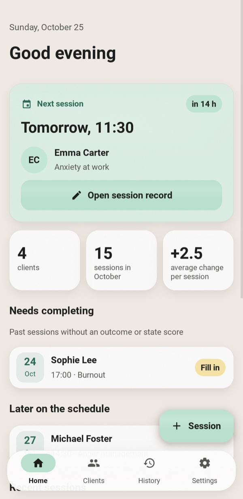
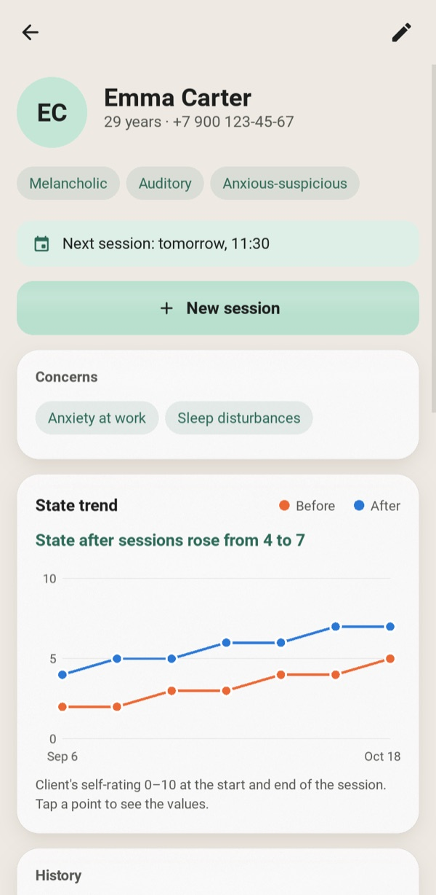
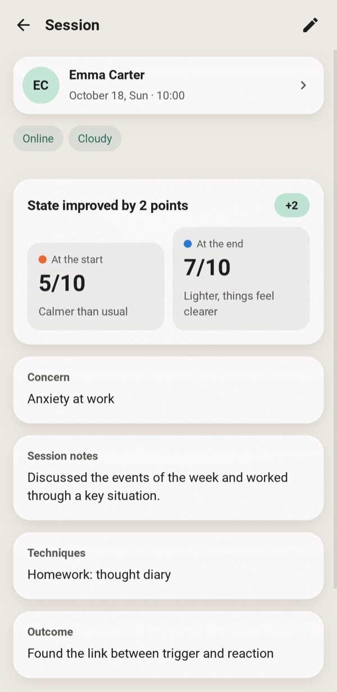
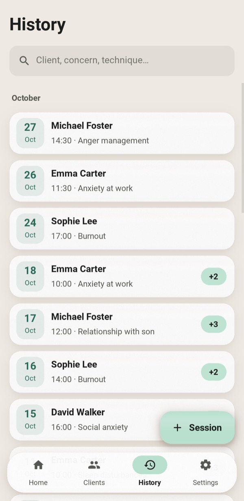
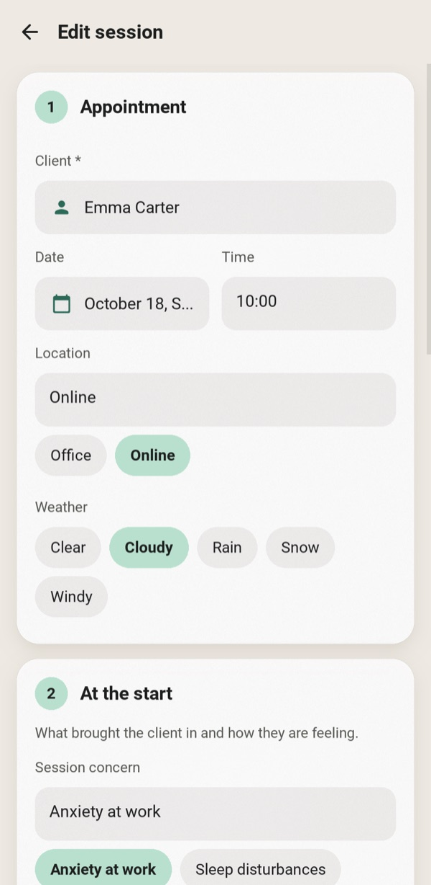
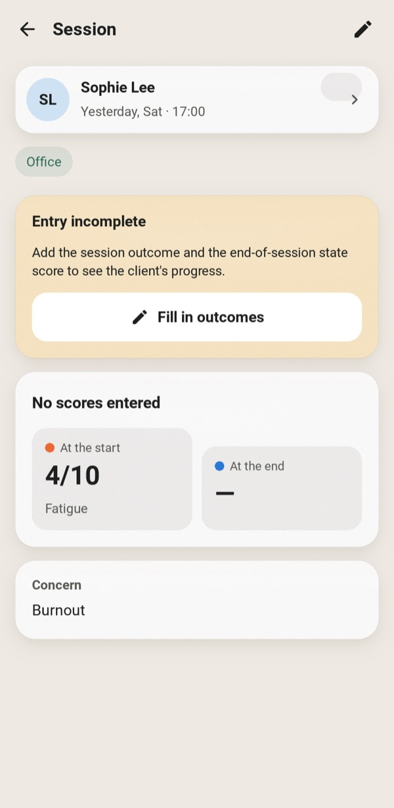
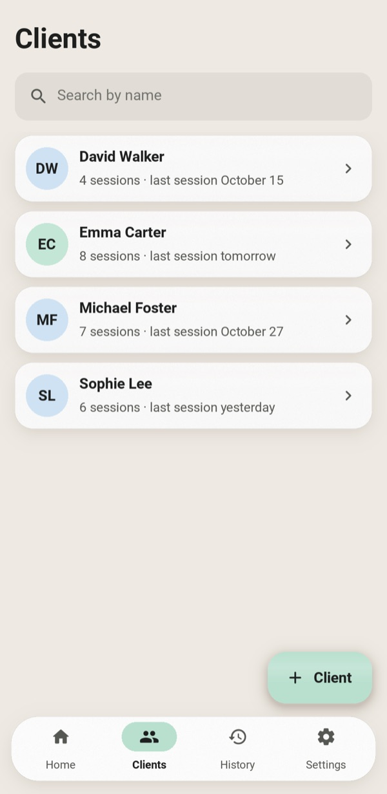
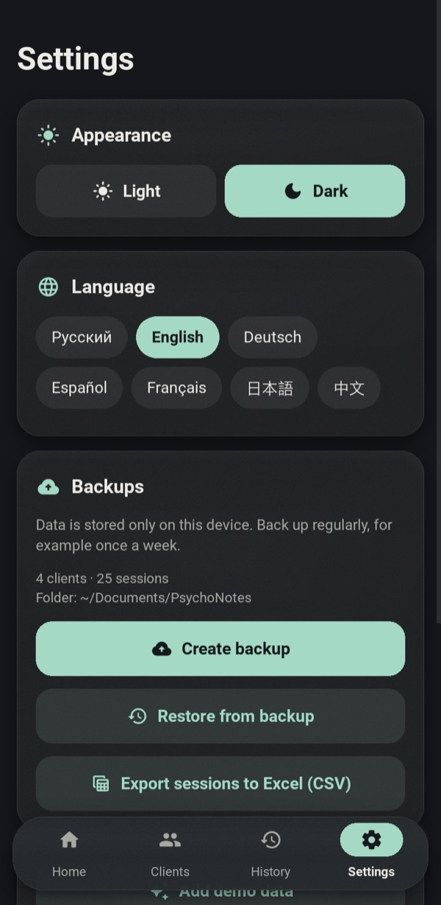
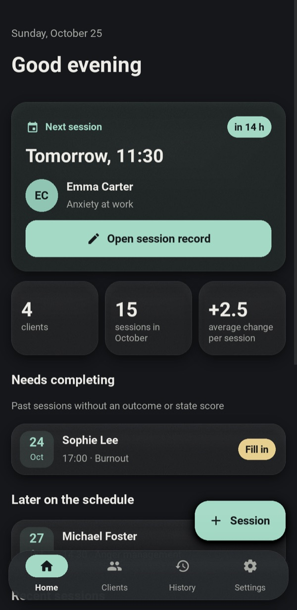
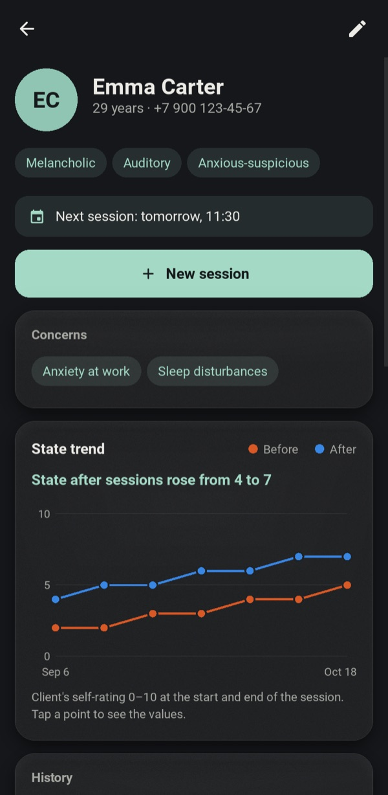

<div align="center">


# PsychoNotes

**A private, offline workspace for practicing psychologists: client records, session notes and progress tracking.**

**English** · [Русский](docs/README.ru.md) · [Deutsch](docs/README.de.md) · [Español](docs/README.es.md) · [Français](docs/README.fr.md) · [日本語](docs/README.ja.md) · [中文](docs/README.zh.md)







</div>

---

Paper notes get lost, and spreadsheets don't fit how therapy works. PsychoNotes keeps each client's profile, every session and the client's state over time in one place. Nothing leaves the device: there's no account, no cloud and no network access.

The interface is available in seven languages: English, Russian, German, Spanish, French, Japanese and Chinese. On first start the app follows the system language, and you can switch at any time in Settings without restarting.

## Features

### What matters most comes first
- **The next appointment** is the hero card on the home screen. It shows a countdown and opens that session's notes in one tap.
- **Needs completing** lists past sessions still missing an outcome or a final score, so no write-up gets forgotten.
- An unfinished session shows a reminder banner. Leaving a form with unsaved edits asks before discarding them.

### Clients and sessions
- **Client profile:** age, phone, temperament, perception modality, character type, anamnesis and help plan.
- **Requests:** a client can have any number of presenting requests. They come back as one-tap suggestions when you record a session.
- **Session form** in four steps: meeting, at the start, the work, the outcome.
- **State scores:** rated 0–10 at the start and at the end, on a colour-coded scale from "bad" to "excellent".
- **Quick input:** a date picker, chips for place and weather, and client selection from a list. A new client can be created right there.
- **Search** is instant and case-insensitive in any script, Cyrillic included. It covers clients, requests and techniques.

### Progress
- **Per-client chart** of the before and after scores across sessions. Tap or hover a point for its values.
- **Plain-language summary** under the chart, such as "State after sessions rose from 4 to 7".
- **Per-session change** ("+3") is shown on every session.

### Your data
- **JSON backup and restore.** A restore validates the file first and rolls back completely if anything is wrong.
- **CSV export** of all sessions, with column headers in the interface language. It opens in Excel with any script intact.
- **Seven languages**, switched live in Settings: dates, plurals and the demo data follow the language too.
- **Light and dark themes** in soft pastels with matte, frosted panels.
- **Demo data:** one tap loads a few fictional clients to explore the app with.

<table>
<tr>
<td align="center" width="25%"><br><sub>Four-step session form</sub></td>
<td align="center" width="25%"><br><sub>Unfinished session reminder</sub></td>
<td align="center" width="25%"><br><sub>Clients</sub></td>
<td align="center" width="25%"><br><sub>Themes, languages, backups</sub></td>
</tr>
</table>

### Dark theme

<p align="center">


</p>

## Getting started

```bash
git clone https://github.com/efrom-K/PsychoNotes.git
cd PsychoNotes
python -m venv .venv && source .venv/bin/activate   # Windows: .venv\Scripts\activate
pip install -r requirements.txt
python main.py
```

On first launch, tap **Try it with demo data** to load a few fictional clients.

The database lives in the OS user-data folder, for example `~/Library/Application Support/psychonotes/` on macOS or `%APPDATA%\psychonotes\` on Windows. Backups are saved to `~/Documents/PsychoNotes`. On Android they go to the app's own folder, which file managers can see.

### Packaging

| Target | Command |
|---|---|
| Android APK | `buildozer android debug` (config in `buildozer.spec`). Builds for arm64-v8a and armeabi-v7a, with a minimum of Android 7.0. The first build takes about 30 min; later ones take about a minute. See the notes below. |
| Windows / macOS app | `pyinstaller --name PsychoNotes --windowed --icon assets/icon.png --add-data "ui.kv:." --add-data "assets:assets" --add-data "locales:locales" main.py` (on Windows, use `;` instead of `:`) |

<details>
<summary><b>Building the APK on macOS</b></summary>

- Use `openjdk@21` as `JAVA_HOME`. Put GNU `libtool` first in `PATH` (`/opt/homebrew/opt/libtool/libexec/gnubin`). Run buildozer from a virtualenv with `VIRTUAL_ENV` set.
- The current python-for-android master needs two local fixes in `.buildozer/android/platform/python-for-android`:
  - `pythonforandroid/recipes/kivy/__init__.py`: set `python_depends = ['filetype']`. `requests` pulls in an Android-only `charset_normalizer` wheel that the host pip refuses to install. The app makes no network requests, so nothing is lost.
  - `pythonforandroid/build.py`, in `run_pymodules_install`: create the venv with `'-m', 'venv', '--clear', 'venv'`. Otherwise the second ABI reuses the first ABI's venv, two pip versions get mixed, and pip fails with `ImportError: BuildDependencyInstallError`.
- `Traceback` lines from `pip install ... --dry-run` in the log are harmless. They mean no prebuilt Android wheel exists, so the package is built from source.

</details>

## Under the hood

| | |
|---|---|
| **UI** | Kivy 2.3 with every layout in a single `ui.kv`. No KivyMD and no third-party widgets. |
| **Icons** | Material Icons Round, cut down to the 33 glyphs the app uses: **6 KB** instead of 400 KB. |
| **Languages** | `tr()` looks up the Russian source string in `locales/<lang>.json` and falls back to it. Templates carry the word order, so dates, plurals and "in 2 h 15 min" read naturally in each language. Japanese and Chinese use the system's CJK font (Noto Sans CJK on Android), since Roboto has no ideographs. |
| **Storage** | SQLite (stdlib) with foreign-key cascades, indexes and a Unicode-aware `casefold()` SQL function for search. |
| **Lists** | `RecycleView` for clients and history, so only the rows on screen exist. |
| **Glass effect** | A translucent fill, a 1:1 grain texture and a soft highlight on a GPU `BoxShadow`. No real-time blur and no per-frame FBOs. |
| **Startup** | Only the home screen is built at launch. Other screens are created on first visit. |

Measured on an M-series Mac with a stress database of 300 clients and 6,000 sessions:

| Metric | Result |
|---|---|
| Launch to first frame | ~0.5 s |
| Scrolling the 6,000-row history | steady 13 ms/frame (vsync-bound) |
| Heaviest query (all sessions) | ~22 ms |
| Memory above a bare Kivy window | +36 MB |
| App source + assets | ~140 KB |

```
main.py          app shell, navigation, screens, chart widget
ui.kv            every layout and style; colour tokens come from the theme in main.py
database.py      SQLite layer, pure stdlib (no Kivy), with backup/restore and CSV
i18n.py          translation lookup and plural rules
locales/         one JSON file per language, keyed by the Russian source strings
fmt.py           localized dates and "in 2 h 15 min"
demo.py          fictional sample data
test_database.py unit tests for the data layer and formatting
test_i18n.py     every string translated in every language, with the same {placeholders}
tools/           GUI smoke test, screenshot generator for this README
```

## Tests

```bash
python -m unittest                  # data layer, formatting and translations, no Kivy needed
.venv/bin/python tools/smoke.py     # GUI smoke test: drives real flows in a live window
```

The unit tests run on any Python 3.9+ with nothing to install. The smoke test opens a window and walks through the main flows:
- creating a client and a session through the pickers;
- the unsaved-changes prompt and rejection of invalid input;
- deletion, and backup and restore;
- a real touch on a button, routed through Kivy's input loop;
- a live language switch, then every screen in every language.

The screenshots in this README are generated by `tools/screenshots.py`. Set `PSYCHONOTES_LANG=en` (or another code) to render them in that language.

## Privacy

- All data stays in a local SQLite file. The app makes no network requests.
- Android backup to Google's cloud is turned off (`android.allow_backup = False`).
- Treat backup files like the records they contain: they are plain JSON.

## Translations

To fix a translation, edit `locales/<lang>.json`. To add a language, run `python test_i18n.py keys > locales/xx.json`, fill in the values, and add the code to `LANGS` in `i18n.py`. `python -m unittest test_i18n` reports missing keys and broken placeholders.

## Upgrading from 1.x

The database schema is unchanged. On first start, 2.0 copies an existing `psychologist_notes.db` from the app folder into the user-data folder. Version 2.0 also fixes several 1.x bugs:
- Editing a session no longer wipes the client's anamnesis and requests.
- Deleting a client now also removes their sessions.
- A session is linked to a client picked from a list rather than a typed name, so typos no longer create duplicate clients.

## License

[MIT](LICENSE) © Efim Romanchenko

Icons: [Material Icons](https://github.com/google/material-design-icons) by Google, Apache License 2.0 (subset in `assets/icons.otf`).
