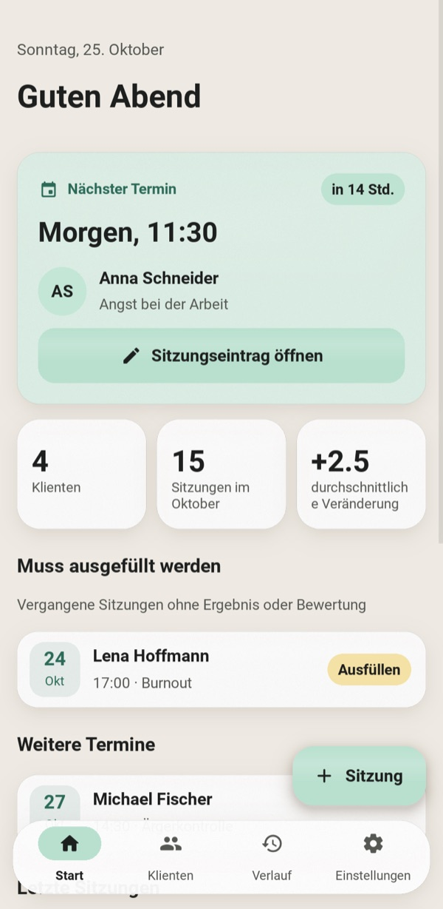
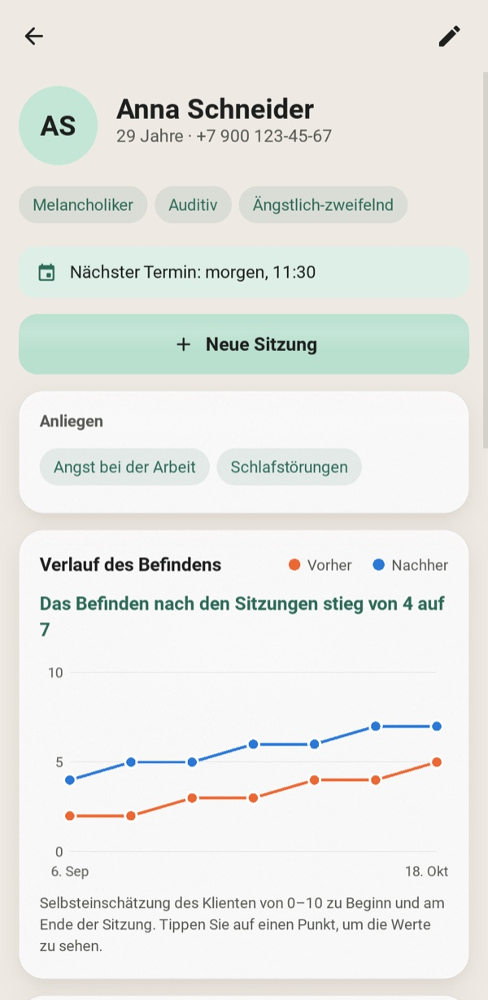
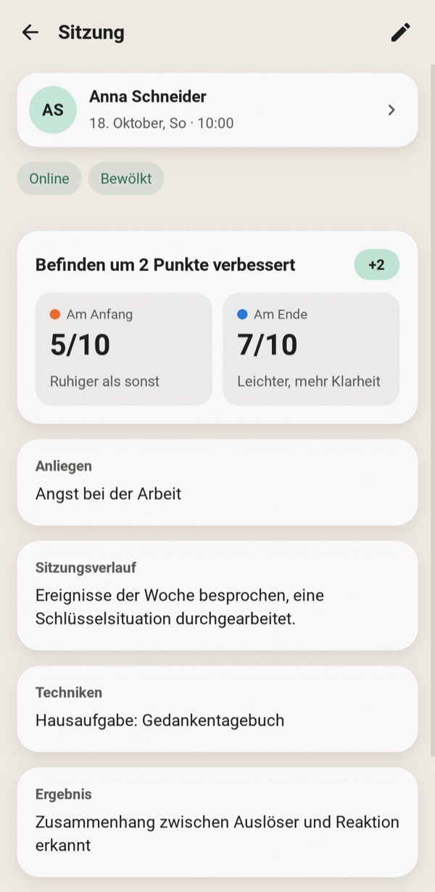
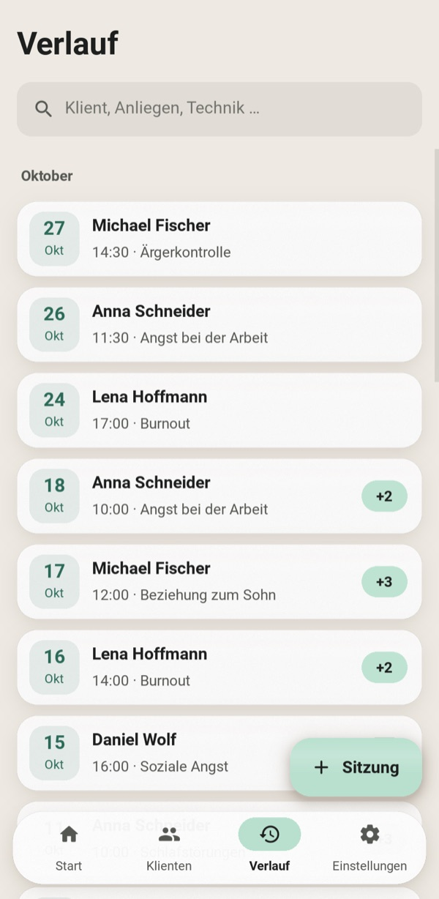
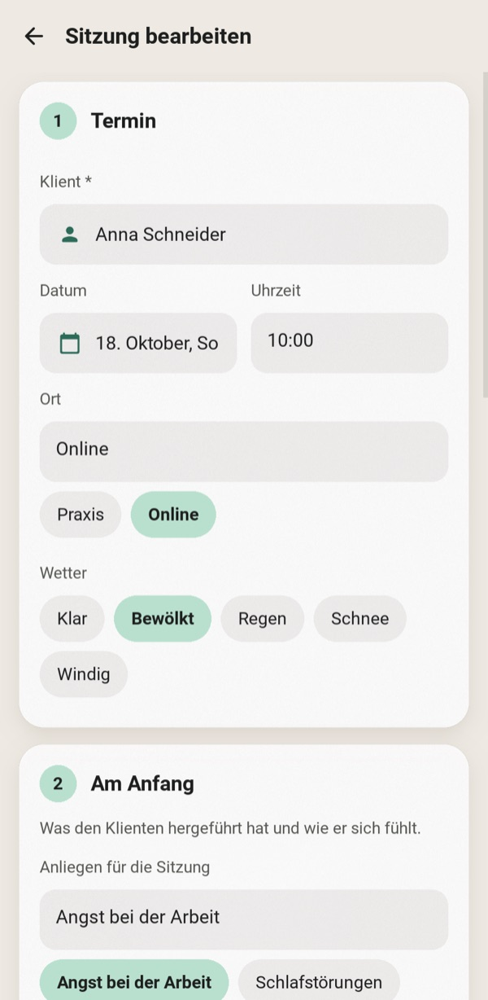
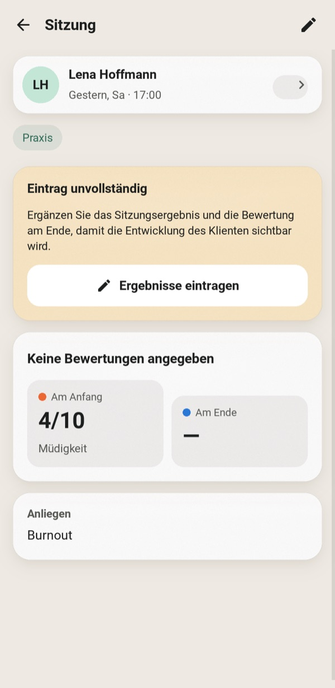
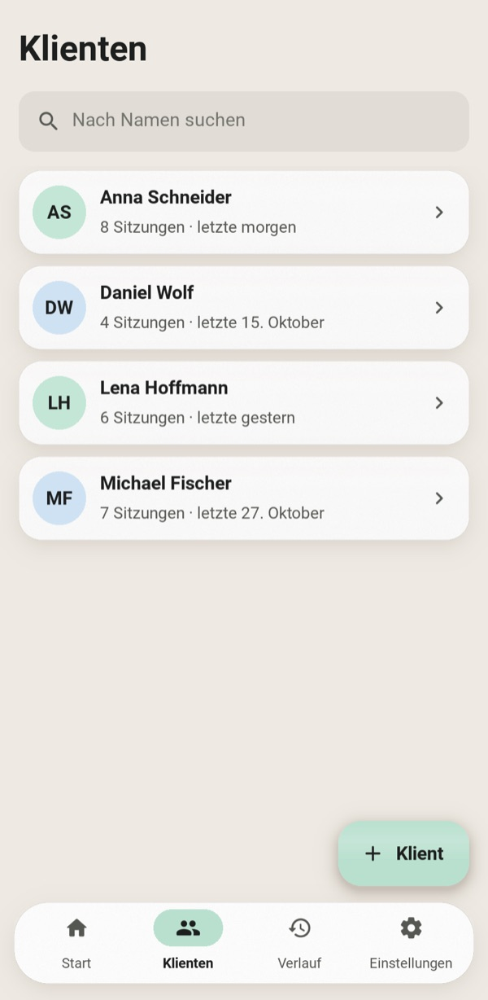
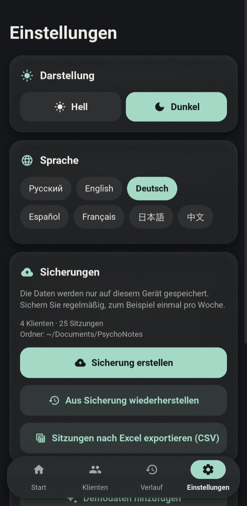
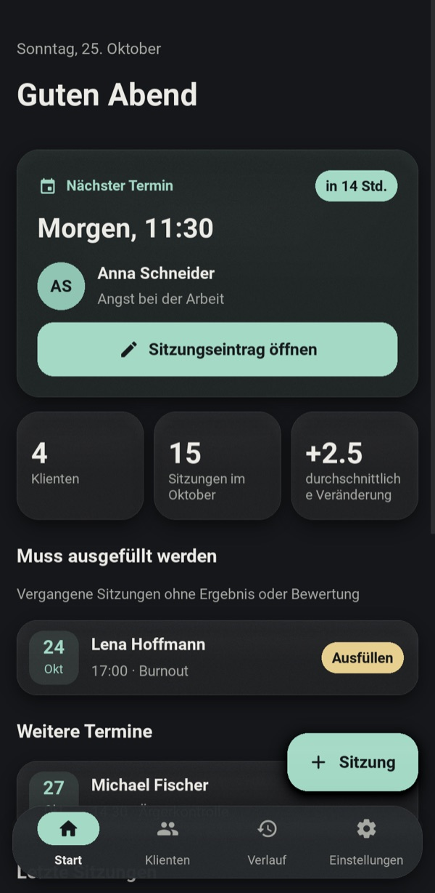
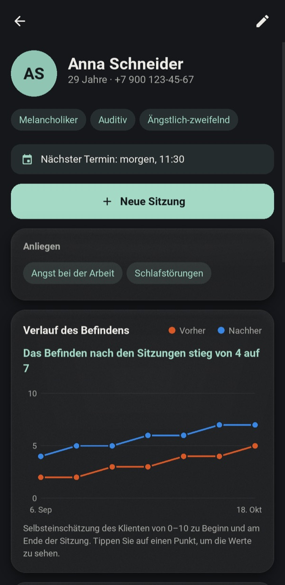

<div align="center">


# PsychoNotes

**Ein privater Offline-Arbeitsplatz für praktizierende Psychologinnen und Psychologen: Klientenakten, Sitzungsnotizen und Verlaufsdokumentation.**

[English](../README.md) · [Русский](README.ru.md) · **Deutsch** · [Español](README.es.md) · [Français](README.fr.md) · [日本語](README.ja.md) · [中文](README.zh.md)







</div>

---

Papiernotizen gehen verloren, und Tabellen passen nicht zur Arbeitsweise einer Therapie. PsychoNotes hält das Profil jedes Klienten, jede Sitzung und die Entwicklung seines Befindens an einem Ort fest. Nichts verlässt das Gerät: kein Konto, keine Cloud, kein Netzwerkzugriff.

Die Oberfläche gibt es in sieben Sprachen: Englisch, Russisch, Deutsch, Spanisch, Französisch, Japanisch und Chinesisch. Beim ersten Start übernimmt die App die Systemsprache; in den Einstellungen lässt sie sich jederzeit ohne Neustart wechseln.

## Funktionen

### Das Wichtigste zuerst
- **Der nächste Termin** ist die Hauptkarte auf dem Startbildschirm. Sie zeigt einen Countdown und öffnet mit einem Tippen die Notizen dieser Sitzung.
- **Muss ausgefüllt werden** listet vergangene Sitzungen auf, denen noch ein Ergebnis oder eine Abschlussbewertung fehlt, damit keine Dokumentation vergessen wird.
- Eine unfertige Sitzung zeigt ein Erinnerungsbanner. Wer ein Formular mit ungespeicherten Änderungen verlässt, wird vor dem Verwerfen gefragt.

### Klienten und Sitzungen
- **Klientenprofil:** Alter, Telefon, Temperament, Wahrnehmungsmodalität, Charaktertyp, Anamnese und Hilfeplan.
- **Anliegen:** Ein Klient kann beliebig viele Anliegen haben. Sie erscheinen beim Erfassen einer Sitzung als Vorschläge zum Antippen.
- **Sitzungsformular** in vier Schritten: Treffen, Beginn, Arbeit, Ergebnis.
- **Befindensbewertung:** 0–10 zu Beginn und am Ende, auf einer farbcodierten Skala von „schlecht“ bis „ausgezeichnet“.
- **Schnelleingabe:** Datumsauswahl, Chips für Ort und Wetter, Klientenauswahl aus einer Liste. Ein neuer Klient lässt sich direkt dort anlegen.
- **Die Suche** arbeitet sofort und ohne Beachtung der Groß- und Kleinschreibung, in jeder Schrift, auch Kyrillisch. Sie umfasst Klienten, Anliegen und Techniken.

### Verlauf
- **Diagramm pro Klient** mit den Werten vor und nach der Sitzung über alle Sitzungen. Tippen oder Darüberfahren zeigt die Werte eines Punkts.
- **Zusammenfassung in einfacher Sprache** unter dem Diagramm, zum Beispiel „Das Befinden nach den Sitzungen stieg von 4 auf 7“.
- **Veränderung pro Sitzung** („+3“) wird bei jeder Sitzung angezeigt.

### Ihre Daten
- **JSON-Sicherung und -Wiederherstellung.** Beim Wiederherstellen wird die Datei zuerst geprüft; bei einem Fehler wird vollständig zurückgerollt.
- **CSV-Export** aller Sitzungen, mit Spaltenüberschriften in der Sprache der Oberfläche. Öffnet sich in Excel mit allen Schriftzeichen intakt.
- **Sieben Sprachen**, live in den Einstellungen umschaltbar: Auch Datumsangaben, Pluralformen und die Demodaten folgen der Sprache.
- **Helles und dunkles Design** in sanften Pastelltönen mit matten, milchglasartigen Flächen.
- **Demodaten:** Ein Tippen lädt einige fiktive Klienten, mit denen sich die App erkunden lässt.

<table>
<tr>
<td align="center" width="25%"><br><sub>Sitzungsformular in vier Schritten</sub></td>
<td align="center" width="25%"><br><sub>Erinnerung an unfertige Sitzung</sub></td>
<td align="center" width="25%"><br><sub>Klienten</sub></td>
<td align="center" width="25%"><br><sub>Designs, Sprachen, Sicherungen</sub></td>
</tr>
</table>

### Dunkles Design

<p align="center">


</p>

## Erste Schritte

```bash
git clone https://github.com/efrom-K/PsychoNotes.git
cd PsychoNotes
python -m venv .venv && source .venv/bin/activate   # Windows: .venv\Scripts\activate
pip install -r requirements.txt
python main.py
```

Tippen Sie beim ersten Start auf **Mit Demodaten ansehen**, um einige fiktive Klienten zu laden.

Die Datenbank liegt im Benutzerdatenordner des Betriebssystems, zum Beispiel `~/Library/Application Support/psychonotes/` unter macOS oder `%APPDATA%\psychonotes\` unter Windows. Sicherungen werden in `~/Documents/PsychoNotes` gespeichert. Unter Android landen sie im eigenen Ordner der App, den Dateimanager anzeigen können.

### Paketierung

| Ziel | Befehl |
|---|---|
| Android-APK | `buildozer android debug` (Konfiguration in `buildozer.spec`). Baut für arm64-v8a und armeabi-v7a, mindestens Android 7.0. Der erste Build dauert etwa 30 Min., spätere etwa eine Minute. Siehe die Hinweise unten. |
| Windows-/macOS-App | `pyinstaller --name PsychoNotes --windowed --icon assets/icon.png --add-data "ui.kv:." --add-data "assets:assets" --add-data "locales:locales" main.py` (unter Windows `;` statt `:` verwenden) |

<details>
<summary><b>Die APK unter macOS bauen</b></summary>

- Verwenden Sie `openjdk@21` als `JAVA_HOME`. Setzen Sie GNU `libtool` an den Anfang von `PATH` (`/opt/homebrew/opt/libtool/libexec/gnubin`). Starten Sie buildozer aus einem Virtualenv mit gesetzter `VIRTUAL_ENV`.
- Der aktuelle python-for-android-master braucht zwei lokale Korrekturen in `.buildozer/android/platform/python-for-android`:
  - `pythonforandroid/recipes/kivy/__init__.py`: `python_depends = ['filetype']` setzen. `requests` zieht ein nur für Android gebautes `charset_normalizer`-Wheel nach, das das Host-pip nicht installieren will. Die App stellt keine Netzwerkanfragen, es geht also nichts verloren.
  - `pythonforandroid/build.py`, in `run_pymodules_install`: das venv mit `'-m', 'venv', '--clear', 'venv'` anlegen. Sonst nutzt die zweite ABI das venv der ersten weiter, zwei pip-Versionen vermischen sich, und pip bricht mit `ImportError: BuildDependencyInstallError` ab.
- `Traceback`-Zeilen von `pip install ... --dry-run` im Log sind harmlos. Sie bedeuten nur, dass es kein vorgebautes Android-Wheel gibt und das Paket aus dem Quelltext gebaut wird.

</details>

## Unter der Haube

| | |
|---|---|
| **UI** | Kivy 2.3, alle Layouts in einer einzigen `ui.kv`. Kein KivyMD und keine Widgets von Drittanbietern. |
| **Symbole** | Material Icons Round, auf die 33 von der App verwendeten Glyphen reduziert: **6 KB** statt 400 KB. |
| **Sprachen** | `tr()` sucht den russischen Quelltext in `locales/<lang>.json` und fällt darauf zurück. Die Vorlagen tragen die Wortstellung, sodass Datumsangaben, Pluralformen und „in 2 Std. 15 Min.“ in jeder Sprache natürlich klingen. Japanisch und Chinesisch nutzen die CJK-Schrift des Systems (Noto Sans CJK unter Android), da Roboto keine Ideogramme enthält. |
| **Speicher** | SQLite (stdlib) mit Fremdschlüssel-Kaskaden, Indizes und einer Unicode-fähigen SQL-Funktion `casefold()` für die Suche. |
| **Listen** | `RecycleView` für Klienten und Verlauf, sodass nur die Zeilen auf dem Bildschirm existieren. |
| **Glaseffekt** | Eine transparente Füllung, eine 1:1-Körnungstextur und ein sanfter Lichtreflex auf einem GPU-`BoxShadow`. Keine Echtzeit-Unschärfe und keine FBOs pro Frame. |
| **Start** | Beim Start wird nur der Startbildschirm aufgebaut. Andere Bildschirme entstehen beim ersten Besuch. |

Gemessen auf einem Mac mit M-Chip und einer Stress-Datenbank mit 300 Klienten und 6.000 Sitzungen:

| Messgröße | Ergebnis |
|---|---|
| Start bis zum ersten Frame | ~0,5 s |
| Scrollen im Verlauf mit 6.000 Zeilen | konstant 13 ms/Frame (vsync-begrenzt) |
| Aufwendigste Abfrage (alle Sitzungen) | ~22 ms |
| Speicher über einem leeren Kivy-Fenster | +36 MB |
| App-Quelltext + Assets | ~140 KB |

```
main.py          App-Gerüst, Navigation, Bildschirme, Diagramm-Widget
ui.kv            alle Layouts und Stile; Farb-Tokens stammen aus dem Theme in main.py
database.py      SQLite-Schicht, reine stdlib (kein Kivy), mit Sicherung/Wiederherstellung und CSV
i18n.py          Übersetzungsnachschlag und Pluralregeln
locales/         eine JSON-Datei pro Sprache, Schlüssel sind die russischen Quelltexte
fmt.py           lokalisierte Datumsangaben und „in 2 Std. 15 Min.“
demo.py          fiktive Beispieldaten
test_database.py Unit-Tests für Datenschicht und Formatierung
test_i18n.py     jeder Text in jeder Sprache übersetzt, mit denselben {Platzhaltern}
tools/           GUI-Smoke-Test, Screenshot-Generator für dieses README
```

## Tests

```bash
python -m unittest                  # Datenschicht, Formatierung und Übersetzungen, kein Kivy nötig
.venv/bin/python tools/smoke.py     # GUI-Smoke-Test: spielt echte Abläufe in einem echten Fenster durch
```

Die Unit-Tests laufen mit jedem Python 3.9+ ohne weitere Installation. Der Smoke-Test öffnet ein Fenster und geht die wichtigsten Abläufe durch:
- Anlegen eines Klienten und einer Sitzung über die Auswahllisten;
- die Abfrage bei ungespeicherten Änderungen und die Zurückweisung ungültiger Eingaben;
- Löschen sowie Sicherung und Wiederherstellung;
- ein echtes Tippen auf eine Schaltfläche, geleitet durch Kivys Eingabeschleife;
- ein Sprachwechsel im laufenden Betrieb, danach jeder Bildschirm in jeder Sprache.

Die Screenshots in diesem README werden von `tools/screenshots.py` erzeugt. Setzen Sie `PSYCHONOTES_LANG=de` (oder einen anderen Code), um sie in dieser Sprache zu rendern.

## Datenschutz

- Alle Daten bleiben in einer lokalen SQLite-Datei. Die App stellt keine Netzwerkanfragen.
- Die Android-Sicherung in Googles Cloud ist abgeschaltet (`android.allow_backup = False`).
- Behandeln Sie Sicherungsdateien wie die Akten, die sie enthalten: Es ist einfaches JSON.

## Übersetzungen

Um eine Übersetzung zu korrigieren, bearbeiten Sie `locales/<lang>.json`. Um eine Sprache hinzuzufügen, führen Sie `python test_i18n.py keys > locales/xx.json` aus, tragen Sie die Werte ein und ergänzen Sie den Code in `LANGS` in `i18n.py`. `python -m unittest test_i18n` meldet fehlende Schlüssel und defekte Platzhalter.

## Umstieg von 1.x

Das Datenbankschema ist unverändert. Beim ersten Start kopiert 2.0 eine vorhandene `psychologist_notes.db` aus dem App-Ordner in den Benutzerdatenordner. Version 2.0 behebt außerdem mehrere Fehler aus 1.x:
- Das Bearbeiten einer Sitzung löscht nicht mehr die Anamnese und die Anliegen des Klienten.
- Das Löschen eines Klienten entfernt jetzt auch seine Sitzungen.
- Eine Sitzung wird mit einem aus einer Liste gewählten Klienten verknüpft statt mit einem getippten Namen, sodass Tippfehler keine doppelten Klienten mehr erzeugen.

## Lizenz

[MIT](../LICENSE) © Efim Romanchenko

Symbole: [Material Icons](https://github.com/google/material-design-icons) von Google, Apache License 2.0 (Teilmenge in `assets/icons.otf`).
