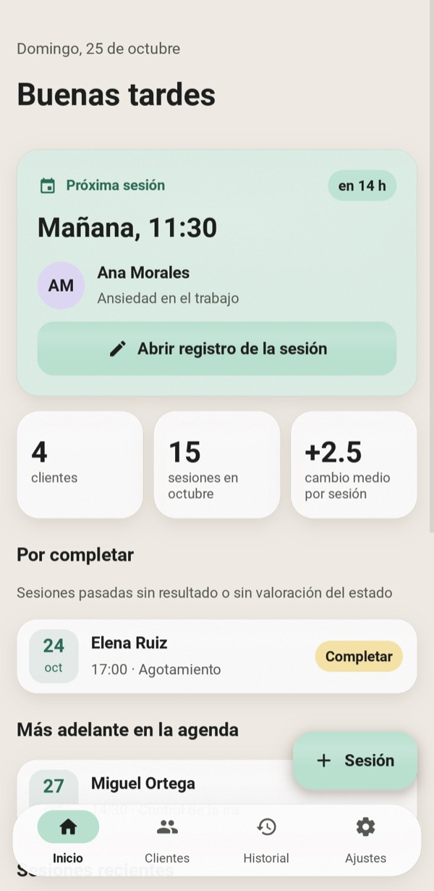
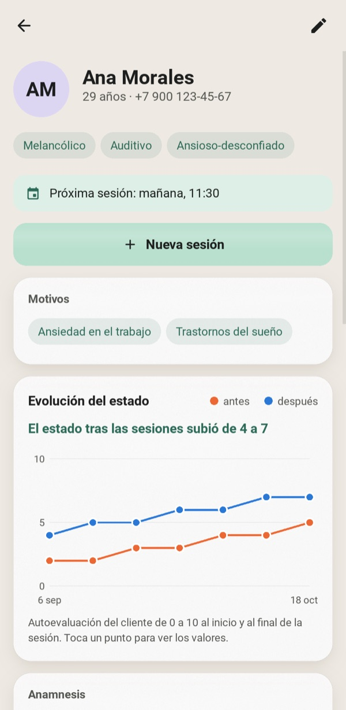
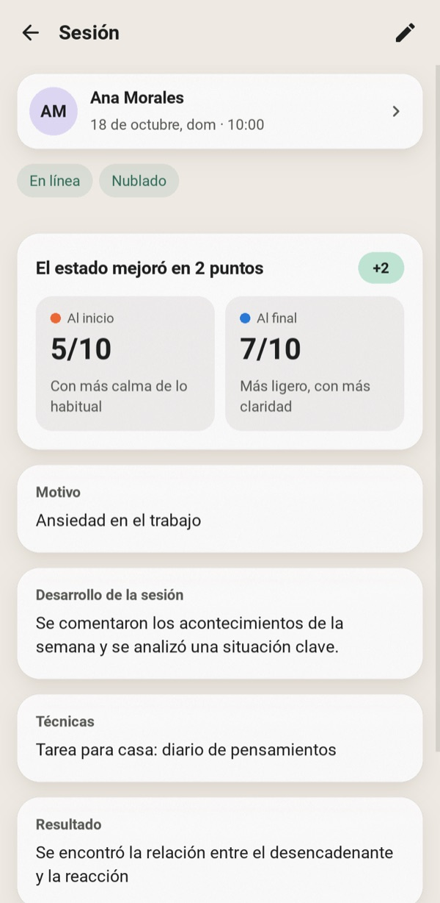
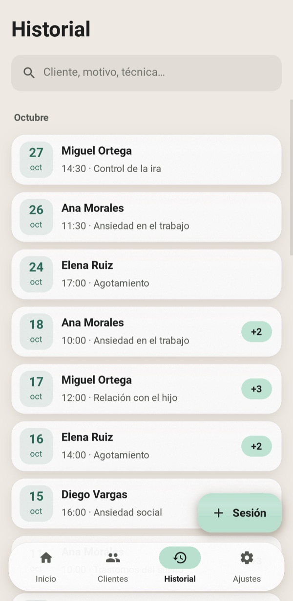
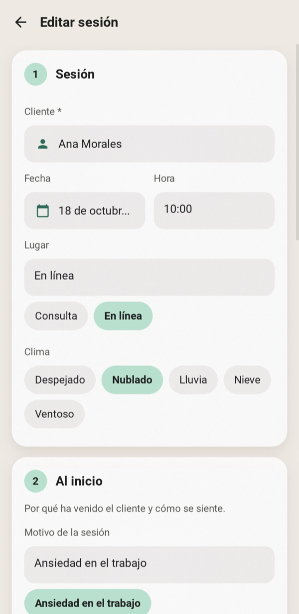
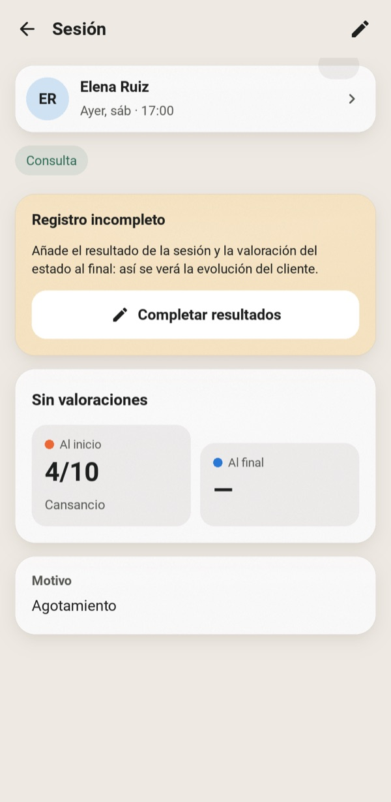
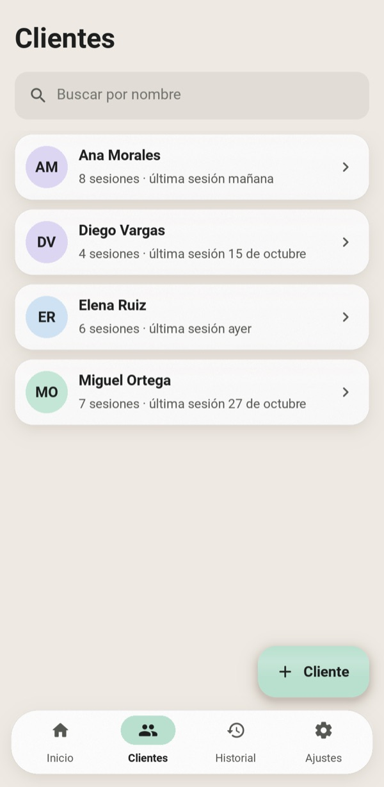
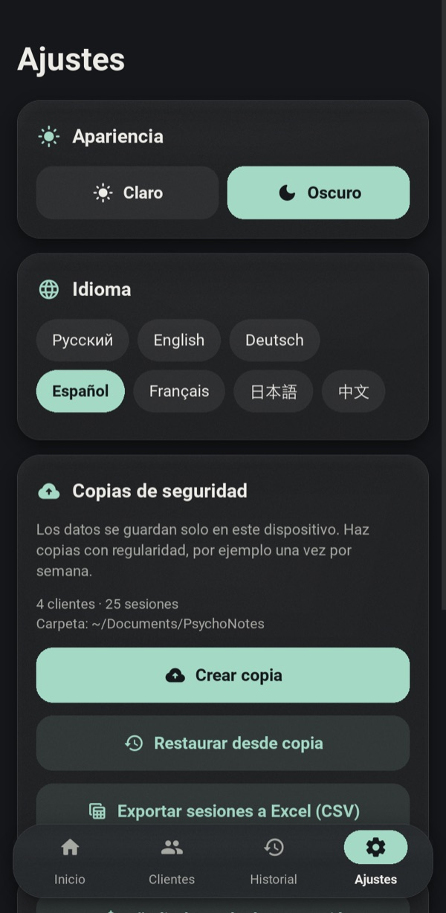
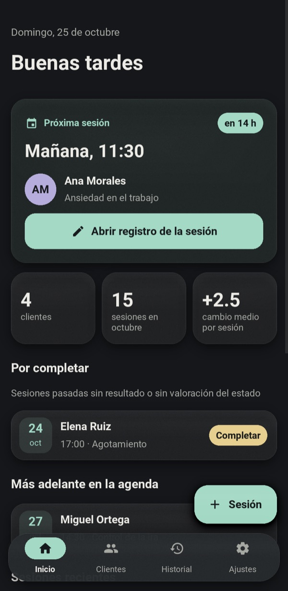
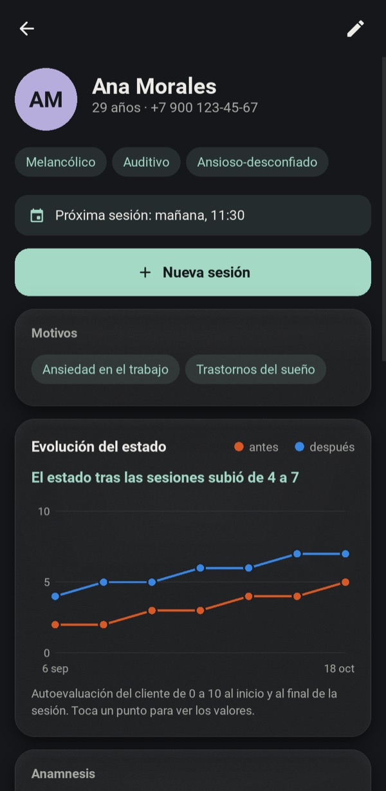

<div align="center">


# PsychoNotes

**Un espacio de trabajo privado y sin conexión para psicólogos en ejercicio: fichas de clientes, notas de sesión y seguimiento del progreso.**

[English](../README.md) · [Русский](README.ru.md) · [Deutsch](README.de.md) · **Español** · [Français](README.fr.md) · [日本語](README.ja.md) · [中文](README.zh.md)







</div>

---

Las notas en papel se pierden y las hojas de cálculo no encajan con el modo en que funciona la terapia. PsychoNotes reúne en un solo lugar la ficha de cada cliente, todas sus sesiones y la evolución de su estado. Nada sale del dispositivo: no hay cuenta, ni nube, ni acceso a la red.

La interfaz está disponible en siete idiomas: inglés, ruso, alemán, español, francés, japonés y chino. En el primer inicio la aplicación sigue el idioma del sistema, y puedes cambiarlo en cualquier momento en Ajustes sin reiniciar.

## Funciones

### Lo más importante, primero
- **La próxima cita** es la tarjeta destacada de la pantalla de inicio. Muestra una cuenta atrás y abre las notas de esa sesión con un solo toque.
- **Por completar** enumera las sesiones pasadas a las que aún les falta un resultado o una puntuación final, para que no se olvide ningún registro.
- Una sesión sin terminar muestra un banner recordatorio. Al salir de un formulario con cambios sin guardar, la aplicación pregunta antes de descartarlos.

### Clientes y sesiones
- **Ficha del cliente:** edad, teléfono, temperamento, modalidad de percepción, tipo de carácter, anamnesis y plan de ayuda.
- **Demandas:** un cliente puede tener cualquier número de demandas. Aparecen como sugerencias de un toque al registrar una sesión.
- **Formulario de sesión** en cuatro pasos: encuentro, al inicio, el trabajo, el resultado.
- **Puntuaciones de estado:** de 0 a 10 al inicio y al final, en una escala de colores de «mal» a «excelente».
- **Entrada rápida:** selector de fecha, chips para lugar y clima, y elección del cliente en una lista. Se puede crear un cliente nuevo allí mismo.
- **La búsqueda** es instantánea y no distingue mayúsculas de minúsculas en ningún alfabeto, cirílico incluido. Abarca clientes, demandas y técnicas.

### Progreso
- **Gráfico por cliente** de las puntuaciones de antes y después a lo largo de las sesiones. Toca un punto o pasa el cursor por encima para ver sus valores.
- **Resumen en lenguaje sencillo** bajo el gráfico, por ejemplo «El estado tras las sesiones subió de 4 a 7».
- **El cambio por sesión** («+3») se muestra en cada sesión.

### Tus datos
- **Copia de seguridad y restauración en JSON.** Al restaurar, primero se valida el archivo y, si algo falla, se revierte todo por completo.
- **Exportación a CSV** de todas las sesiones, con los encabezados de columna en el idioma de la interfaz. Se abre en Excel conservando cualquier alfabeto.
- **Siete idiomas**, que se cambian al instante en Ajustes: las fechas, los plurales y los datos de demostración también siguen el idioma.
- **Temas claro y oscuro** en suaves tonos pastel con paneles mate y esmerilados.
- **Datos de demostración:** con un toque se cargan unos cuantos clientes ficticios para explorar la aplicación.

<table>
<tr>
<td align="center" width="25%"><br><sub>Formulario de sesión en cuatro pasos</sub></td>
<td align="center" width="25%"><br><sub>Recordatorio de sesión sin terminar</sub></td>
<td align="center" width="25%"><br><sub>Clientes</sub></td>
<td align="center" width="25%"><br><sub>Temas, idiomas, copias de seguridad</sub></td>
</tr>
</table>

### Tema oscuro

<p align="center">


</p>

## Primeros pasos

```bash
git clone https://github.com/efrom-K/PsychoNotes.git
cd PsychoNotes
python -m venv .venv && source .venv/bin/activate   # Windows: .venv\Scripts\activate
pip install -r requirements.txt
python main.py
```

En el primer inicio, toca **Ver con datos de demostración** para cargar unos cuantos clientes ficticios.

La base de datos se guarda en la carpeta de datos de usuario del sistema, por ejemplo `~/Library/Application Support/psychonotes/` en macOS o `%APPDATA%\psychonotes\` en Windows. Las copias de seguridad se guardan en `~/Documents/PsychoNotes`. En Android van a la carpeta propia de la aplicación, visible desde los gestores de archivos.

### Empaquetado

| Destino | Comando |
|---|---|
| APK de Android | `buildozer android debug` (configuración en `buildozer.spec`). Compila para arm64-v8a y armeabi-v7a, con Android 7.0 como mínimo. La primera compilación tarda unos 30 min; las siguientes, alrededor de un minuto. Consulta las notas de abajo. |
| Aplicación para Windows / macOS | `pyinstaller --name PsychoNotes --windowed --icon assets/icon.png --add-data "ui.kv:." --add-data "assets:assets" --add-data "locales:locales" main.py` (en Windows, usa `;` en lugar de `:`) |

<details>
<summary><b>Compilar el APK en macOS</b></summary>

- Usa `openjdk@21` como `JAVA_HOME`. Pon `libtool` de GNU al principio del `PATH` (`/opt/homebrew/opt/libtool/libexec/gnubin`). Ejecuta buildozer desde un entorno virtual con `VIRTUAL_ENV` definido.
- La rama master actual de python-for-android necesita dos correcciones locales en `.buildozer/android/platform/python-for-android`:
  - `pythonforandroid/recipes/kivy/__init__.py`: define `python_depends = ['filetype']`. `requests` arrastra una wheel de `charset_normalizer` exclusiva de Android que el pip del host se niega a instalar. La aplicación no hace peticiones de red, así que no se pierde nada.
  - `pythonforandroid/build.py`, en `run_pymodules_install`: crea el venv con `'-m', 'venv', '--clear', 'venv'`. De lo contrario, la segunda ABI reutiliza el venv de la primera, se mezclan dos versiones de pip y pip falla con `ImportError: BuildDependencyInstallError`.
- Las líneas `Traceback` de `pip install ... --dry-run` en el registro son inofensivas. Significan que no existe una wheel de Android precompilada, por lo que el paquete se compila desde el código fuente.

</details>

## Bajo el capó

| | |
|---|---|
| **UI** | Kivy 2.3 con todos los diseños en un único `ui.kv`. Sin KivyMD ni widgets de terceros. |
| **Iconos** | Material Icons Round, reducido a los 33 glifos que usa la aplicación: **6 KB** en lugar de 400 KB. |
| **Idiomas** | `tr()` busca la cadena fuente en ruso en `locales/<lang>.json` y, si no la encuentra, recurre a ella. Las plantillas llevan el orden de las palabras, así que las fechas, los plurales y «en 2 h 15 min» suenan naturales en cada idioma. El japonés y el chino usan la fuente CJK del sistema (Noto Sans CJK en Android), porque Roboto no tiene ideogramas. |
| **Almacenamiento** | SQLite (biblioteca estándar) con cascadas de claves foráneas, índices y una función SQL `casefold()` compatible con Unicode para la búsqueda. |
| **Listas** | `RecycleView` para clientes e historial, de modo que solo existen las filas visibles en pantalla. |
| **Efecto cristal** | Un relleno translúcido, una textura de grano 1:1 y un suave brillo sobre un `BoxShadow` en la GPU. Sin desenfoque en tiempo real ni FBO por fotograma. |
| **Arranque** | Al iniciar solo se construye la pantalla de inicio. Las demás pantallas se crean en la primera visita. |

Medido en un Mac de la serie M con una base de datos de estrés de 300 clientes y 6.000 sesiones:

| Métrica | Resultado |
|---|---|
| Del arranque al primer fotograma | ~0,5 s |
| Desplazamiento por el historial de 6.000 filas | 13 ms/fotograma constantes (limitado por vsync) |
| Consulta más pesada (todas las sesiones) | ~22 ms |
| Memoria sobre una ventana Kivy vacía | +36 MB |
| Código fuente + recursos | ~140 KB |

```
main.py          app shell, navigation, screens, chart widget
ui.kv            every layout and style; colour tokens come from the theme in main.py
database.py      SQLite layer, pure stdlib (no Kivy), with backup/restore and CSV
i18n.py          translation lookup and plural rules
locales/         one JSON file per language, keyed by the Russian source strings
fmt.py           localized dates and "in 2 h 15 min"
demo.py          fictional sample data
test_database.py unit tests for the data layer and formatting
test_i18n.py     every string translated in every language, with the same {placeholders}
tools/           GUI smoke test, screenshot generator for this README
```

## Pruebas

```bash
python -m unittest                  # data layer, formatting and translations, no Kivy needed
.venv/bin/python tools/smoke.py     # GUI smoke test: drives real flows in a live window
```

Las pruebas unitarias funcionan en cualquier Python 3.9+ sin instalar nada. La prueba de humo abre una ventana y recorre los flujos principales:
- crear un cliente y una sesión mediante los selectores;
- el aviso de cambios sin guardar y el rechazo de datos no válidos;
- el borrado, y la copia de seguridad y su restauración;
- un toque real sobre un botón, enrutado por el bucle de entrada de Kivy;
- un cambio de idioma en vivo y, después, cada pantalla en cada idioma.

Las capturas de este README las genera `tools/screenshots.py`. Define `PSYCHONOTES_LANG=es` (u otro código) para generarlas en ese idioma.

## Privacidad

- Todos los datos permanecen en un archivo SQLite local. La aplicación no hace peticiones de red.
- La copia de seguridad de Android en la nube de Google está desactivada (`android.allow_backup = False`).
- Trata los archivos de copia de seguridad como los registros que contienen: son JSON en texto plano.

## Traducciones

Para corregir una traducción, edita `locales/<lang>.json`. Para añadir un idioma, ejecuta `python test_i18n.py keys > locales/xx.json`, rellena los valores y añade el código a `LANGS` en `i18n.py`. `python -m unittest test_i18n` informa de las claves que faltan y de los marcadores de posición rotos.

## Actualizar desde la 1.x

El esquema de la base de datos no ha cambiado. En el primer inicio, la 2.0 copia un `psychologist_notes.db` existente de la carpeta de la aplicación a la carpeta de datos de usuario. La versión 2.0 también corrige varios errores de la 1.x:
- Editar una sesión ya no borra la anamnesis ni las demandas del cliente.
- Eliminar un cliente ahora elimina también sus sesiones.
- Una sesión se vincula a un cliente elegido de una lista en lugar de un nombre escrito a mano, de modo que los errores tipográficos ya no crean clientes duplicados.

## Licencia

[MIT](../LICENSE) © Efim Romanchenko

Iconos: [Material Icons](https://github.com/google/material-design-icons) de Google, licencia Apache 2.0 (subconjunto en `assets/icons.otf`).
