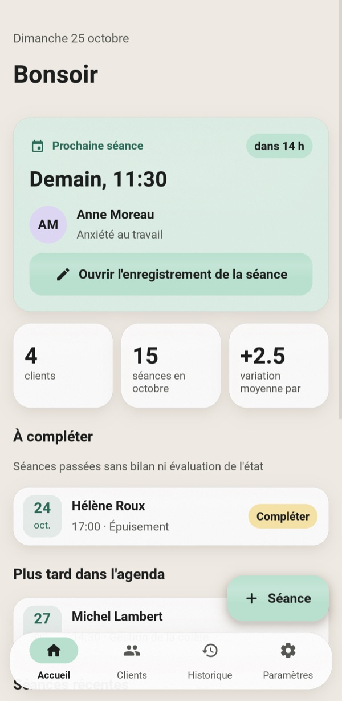
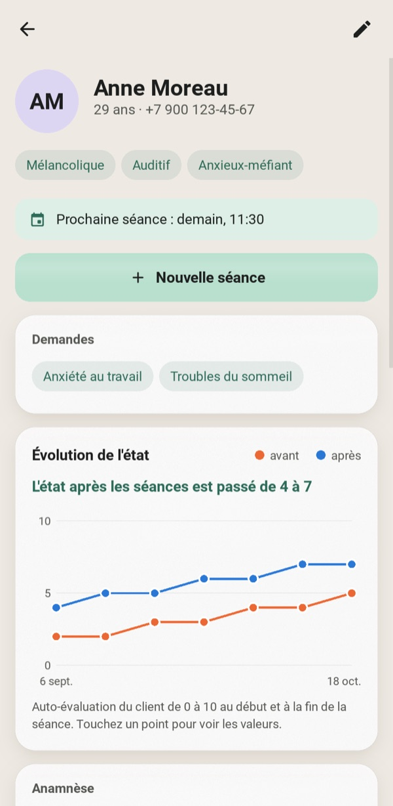
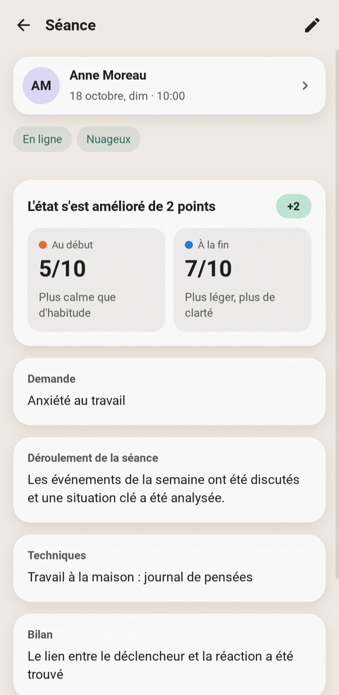
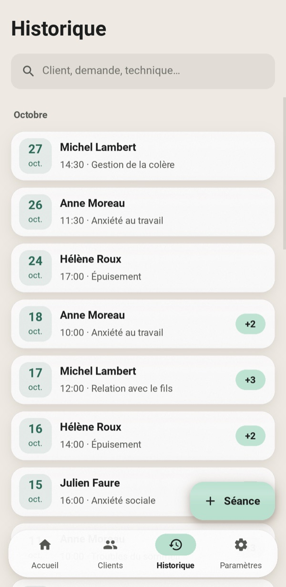
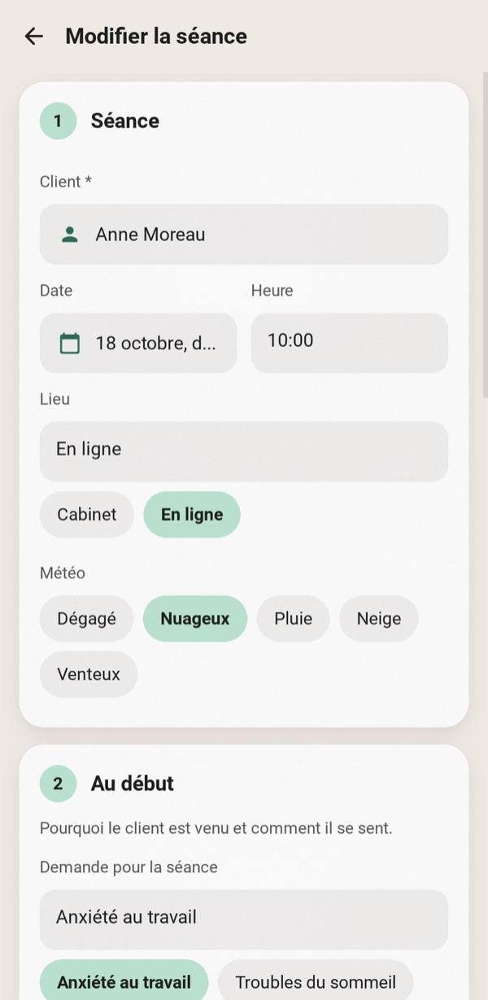
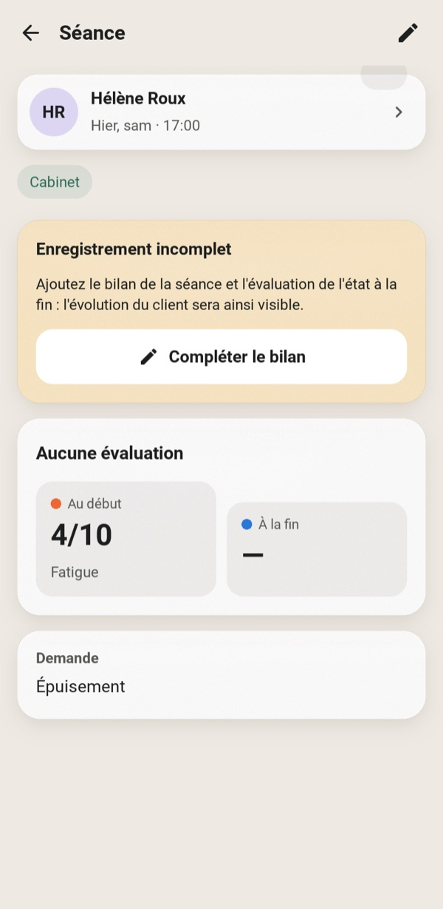
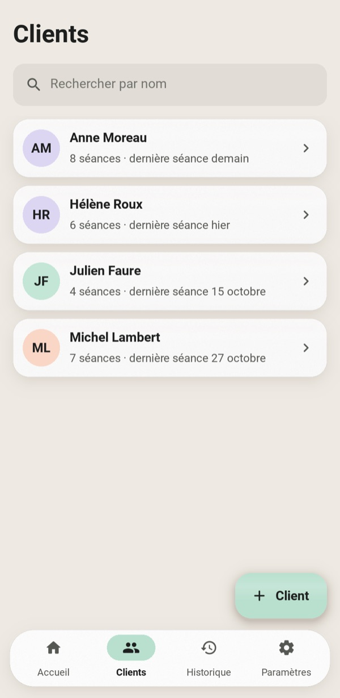
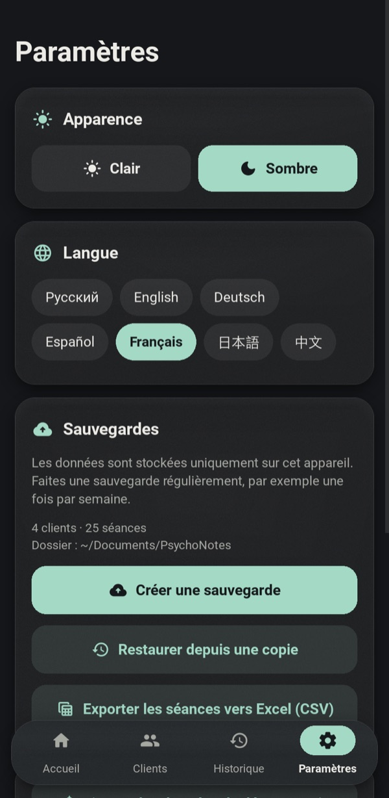
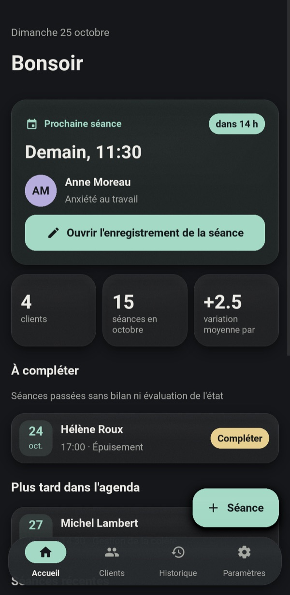
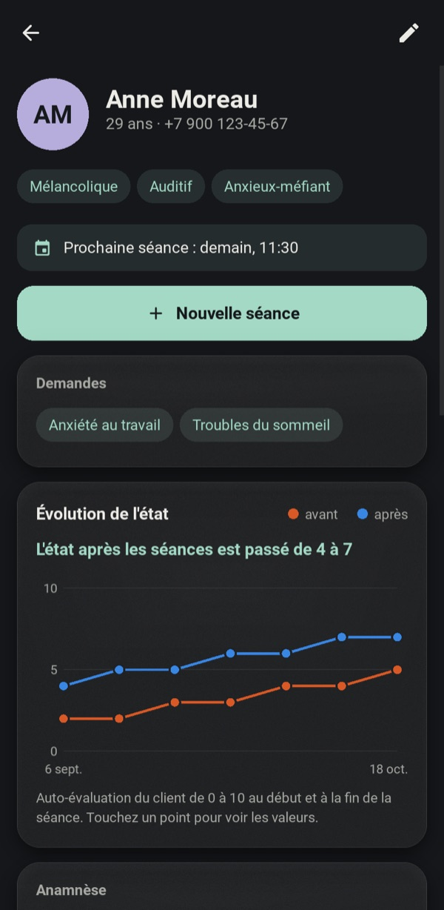

<div align="center">


# PsychoNotes

**Un espace de travail privé et hors ligne pour les psychologues en exercice : dossiers clients, notes de séance et suivi des progrès.**

[English](../README.md) · [Русский](README.ru.md) · [Deutsch](README.de.md) · [Español](README.es.md) · **Français** · [日本語](README.ja.md) · [中文](README.zh.md)







</div>

---

Les notes sur papier se perdent, et les tableurs ne correspondent pas à la façon dont fonctionne une thérapie. PsychoNotes réunit au même endroit le profil de chaque client, chacune de ses séances et l'évolution de son état. Rien ne quitte l'appareil : pas de compte, pas de cloud, pas d'accès réseau.

L'interface est disponible en sept langues : anglais, russe, allemand, espagnol, français, japonais et chinois. Au premier lancement, l'application suit la langue du système, et vous pouvez en changer à tout moment dans les Réglages sans redémarrer.

## Fonctionnalités

### L'essentiel d'abord
- **Le prochain rendez-vous** occupe la carte principale de l'écran d'accueil. Elle affiche un compte à rebours et ouvre les notes de cette séance d'un seul toucher.
- **À compléter** liste les séances passées auxquelles il manque encore un résultat ou une note finale, pour qu'aucun compte rendu ne soit oublié.
- Une séance inachevée affiche une bannière de rappel. Quitter un formulaire contenant des modifications non enregistrées demande confirmation avant de les abandonner.

### Clients et séances
- **Profil du client :** âge, téléphone, tempérament, modalité de perception, type de caractère, anamnèse et plan d'aide.
- **Demandes :** un client peut avoir un nombre quelconque de demandes. Elles reviennent sous forme de suggestions d'un toucher lorsque vous enregistrez une séance.
- **Formulaire de séance** en quatre étapes : la rencontre, le début, le travail, le résultat.
- **Notes d'état :** de 0 à 10 au début et à la fin, sur une échelle de couleurs allant de « mauvais » à « excellent ».
- **Saisie rapide :** sélecteur de date, pastilles pour le lieu et la météo, et choix du client dans une liste. Un nouveau client peut être créé sur place.
- **La recherche** est instantanée et insensible à la casse, quelle que soit l'écriture, cyrillique comprise. Elle porte sur les clients, les demandes et les techniques.

### Progrès
- **Graphique par client** des notes avant et après au fil des séances. Touchez un point ou survolez-le pour voir ses valeurs.
- **Résumé en langage clair** sous le graphique, par exemple « L'état après les séances est passé de 4 à 7 ».
- **L'évolution par séance** (« +3 ») est affichée sur chaque séance.

### Vos données
- **Sauvegarde et restauration JSON.** Une restauration valide d'abord le fichier et annule tout si quelque chose ne va pas.
- **Export CSV** de toutes les séances, avec des en-têtes de colonnes dans la langue de l'interface. Il s'ouvre dans Excel sans altérer aucune écriture.
- **Sept langues**, modifiables à la volée dans les Réglages : les dates, les pluriels et les données de démonstration suivent aussi la langue.
- **Thèmes clair et sombre** aux pastels doux, avec des panneaux mats et dépolis.
- **Données de démonstration :** un toucher charge quelques clients fictifs pour explorer l'application.

<table>
<tr>
<td align="center" width="25%"><br><sub>Formulaire de séance en quatre étapes</sub></td>
<td align="center" width="25%"><br><sub>Rappel de séance inachevée</sub></td>
<td align="center" width="25%"><br><sub>Clients</sub></td>
<td align="center" width="25%"><br><sub>Thèmes, langues, sauvegardes</sub></td>
</tr>
</table>

### Thème sombre

<p align="center">


</p>

## Démarrage

```bash
git clone https://github.com/efrom-K/PsychoNotes.git
cd PsychoNotes
python -m venv .venv && source .venv/bin/activate   # Windows: .venv\Scripts\activate
pip install -r requirements.txt
python main.py
```

Au premier lancement, touchez **Voir avec des données de démonstration** pour charger quelques clients fictifs.

La base de données se trouve dans le dossier de données utilisateur du système, par exemple `~/Library/Application Support/psychonotes/` sous macOS ou `%APPDATA%\psychonotes\` sous Windows. Les sauvegardes sont enregistrées dans `~/Documents/PsychoNotes`. Sur Android, elles vont dans le dossier propre à l'application, visible depuis les gestionnaires de fichiers.

### Empaquetage

| Cible | Commande |
|---|---|
| APK Android | `buildozer android debug` (configuration dans `buildozer.spec`). Compile pour arm64-v8a et armeabi-v7a, avec Android 7.0 au minimum. La première compilation prend environ 30 min ; les suivantes, environ une minute. Voir les notes ci-dessous. |
| Application Windows / macOS | `pyinstaller --name PsychoNotes --windowed --icon assets/icon.png --add-data "ui.kv:." --add-data "assets:assets" --add-data "locales:locales" main.py` (sous Windows, utilisez `;` au lieu de `:`) |

<details>
<summary><b>Compiler l'APK sous macOS</b></summary>

- Utilisez `openjdk@21` comme `JAVA_HOME`. Placez `libtool` de GNU en tête du `PATH` (`/opt/homebrew/opt/libtool/libexec/gnubin`). Lancez buildozer depuis un environnement virtuel avec `VIRTUAL_ENV` défini.
- La branche master actuelle de python-for-android nécessite deux correctifs locaux dans `.buildozer/android/platform/python-for-android` :
  - `pythonforandroid/recipes/kivy/__init__.py` : définissez `python_depends = ['filetype']`. `requests` entraîne une wheel `charset_normalizer` propre à Android que le pip de l'hôte refuse d'installer. L'application n'effectue aucune requête réseau, donc rien n'est perdu.
  - `pythonforandroid/build.py`, dans `run_pymodules_install` : créez le venv avec `'-m', 'venv', '--clear', 'venv'`. Sinon, la seconde ABI réutilise le venv de la première, deux versions de pip se mélangent et pip échoue avec `ImportError: BuildDependencyInstallError`.
- Les lignes `Traceback` issues de `pip install ... --dry-run` dans le journal sont sans gravité. Elles signifient qu'aucune wheel Android précompilée n'existe ; le paquet est alors compilé depuis les sources.

</details>

## Sous le capot

| | |
|---|---|
| **UI** | Kivy 2.3 avec toutes les mises en page dans un seul `ui.kv`. Ni KivyMD, ni widgets tiers. |
| **Icônes** | Material Icons Round, réduit aux 33 glyphes utilisés par l'application : **6 Ko** au lieu de 400 Ko. |
| **Langues** | `tr()` cherche la chaîne source russe dans `locales/<lang>.json` et s'y rabat en cas d'absence. Les modèles portent l'ordre des mots, si bien que les dates, les pluriels et « dans 2 h 15 min » se lisent naturellement dans chaque langue. Le japonais et le chinois utilisent la police CJK du système (Noto Sans CJK sur Android), car Roboto n'a pas d'idéogrammes. |
| **Stockage** | SQLite (bibliothèque standard) avec cascades de clés étrangères, index et une fonction SQL `casefold()` compatible Unicode pour la recherche. |
| **Listes** | `RecycleView` pour les clients et l'historique : seules les lignes visibles à l'écran existent. |
| **Effet verre** | Un remplissage translucide, une texture de grain 1:1 et un léger reflet sur un `BoxShadow` GPU. Pas de flou en temps réel ni de FBO par image. |
| **Démarrage** | Seul l'écran d'accueil est construit au lancement. Les autres écrans sont créés à la première visite. |

Mesuré sur un Mac de la série M avec une base de test de 300 clients et 6 000 séances :

| Mesure | Résultat |
|---|---|
| Du lancement à la première image | ~0,5 s |
| Défilement de l'historique de 6 000 lignes | 13 ms/image stables (limité par la vsync) |
| Requête la plus lourde (toutes les séances) | ~22 ms |
| Mémoire au-delà d'une fenêtre Kivy vide | +36 Mo |
| Code source + ressources | ~140 Ko |

```
main.py          app shell, navigation, screens, chart widget
ui.kv            every layout and style; colour tokens come from the theme in main.py
database.py      SQLite layer, pure stdlib (no Kivy), with backup/restore and CSV
i18n.py          translation lookup and plural rules
locales/         one JSON file per language, keyed by the Russian source strings
fmt.py           localized dates and "in 2 h 15 min"
demo.py          fictional sample data
test_database.py unit tests for the data layer and formatting
test_i18n.py     every string translated in every language, with the same {placeholders}
tools/           GUI smoke test, screenshot generator for this README
```

## Tests

```bash
python -m unittest                  # data layer, formatting and translations, no Kivy needed
.venv/bin/python tools/smoke.py     # GUI smoke test: drives real flows in a live window
```

Les tests unitaires s'exécutent sur n'importe quel Python 3.9+ sans rien installer. Le test de fumée ouvre une fenêtre et parcourt les principaux parcours :
- création d'un client et d'une séance via les sélecteurs ;
- l'invite de modifications non enregistrées et le rejet des saisies invalides ;
- la suppression, ainsi que la sauvegarde et la restauration ;
- un véritable toucher sur un bouton, acheminé par la boucle d'entrée de Kivy ;
- un changement de langue à la volée, puis chaque écran dans chaque langue.

Les captures d'écran de ce README sont générées par `tools/screenshots.py`. Définissez `PSYCHONOTES_LANG=fr` (ou un autre code) pour les produire dans cette langue.

## Confidentialité

- Toutes les données restent dans un fichier SQLite local. L'application n'effectue aucune requête réseau.
- La sauvegarde Android vers le cloud de Google est désactivée (`android.allow_backup = False`).
- Traitez les fichiers de sauvegarde comme les dossiers qu'ils contiennent : ce sont de simples fichiers JSON.

## Traductions

Pour corriger une traduction, modifiez `locales/<lang>.json`. Pour ajouter une langue, exécutez `python test_i18n.py keys > locales/xx.json`, renseignez les valeurs et ajoutez le code à `LANGS` dans `i18n.py`. `python -m unittest test_i18n` signale les clés manquantes et les variables de substitution cassées.

## Mise à niveau depuis la 1.x

Le schéma de la base de données est inchangé. Au premier lancement, la 2.0 copie un éventuel `psychologist_notes.db` du dossier de l'application vers le dossier de données utilisateur. La version 2.0 corrige aussi plusieurs bogues de la 1.x :
- Modifier une séance n'efface plus l'anamnèse ni les demandes du client.
- Supprimer un client supprime désormais aussi ses séances.
- Une séance est liée à un client choisi dans une liste plutôt qu'à un nom saisi à la main, si bien que les fautes de frappe ne créent plus de clients en double.

## Licence

[MIT](../LICENSE) © Efim Romanchenko

Icônes : [Material Icons](https://github.com/google/material-design-icons) de Google, licence Apache 2.0 (sous-ensemble dans `assets/icons.otf`).
