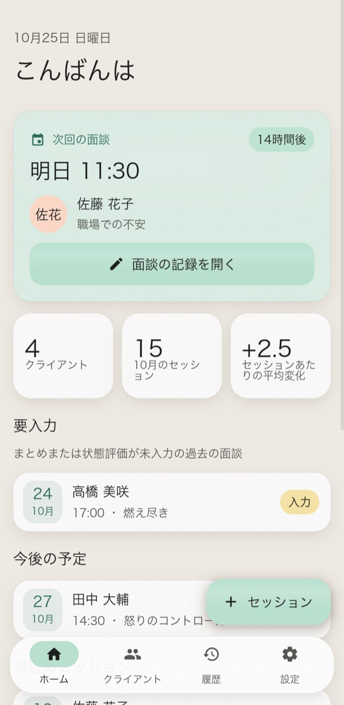
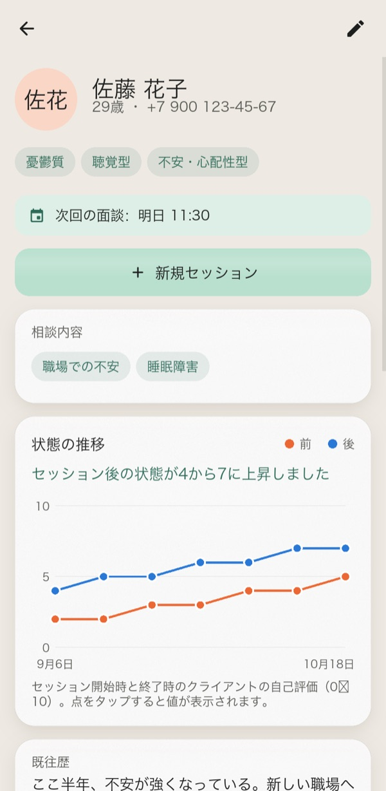
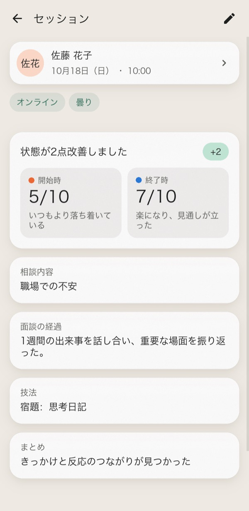
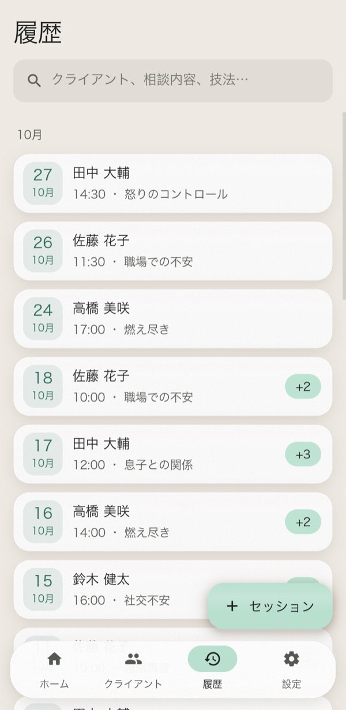
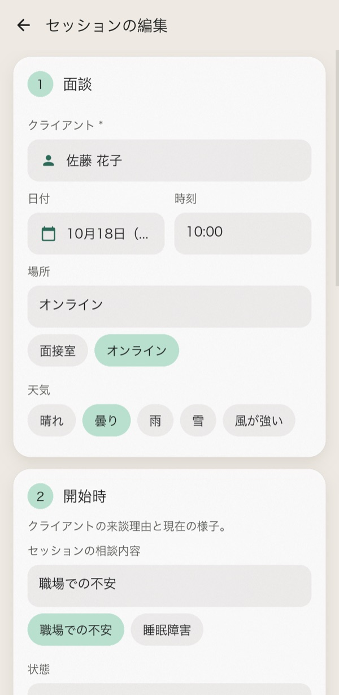
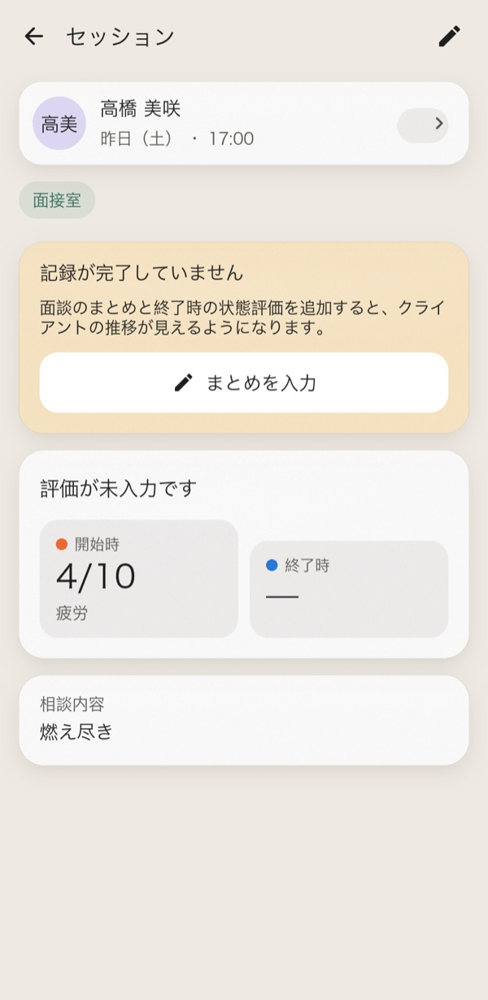
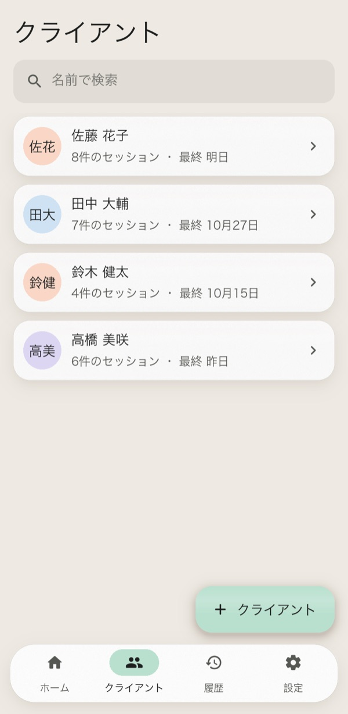
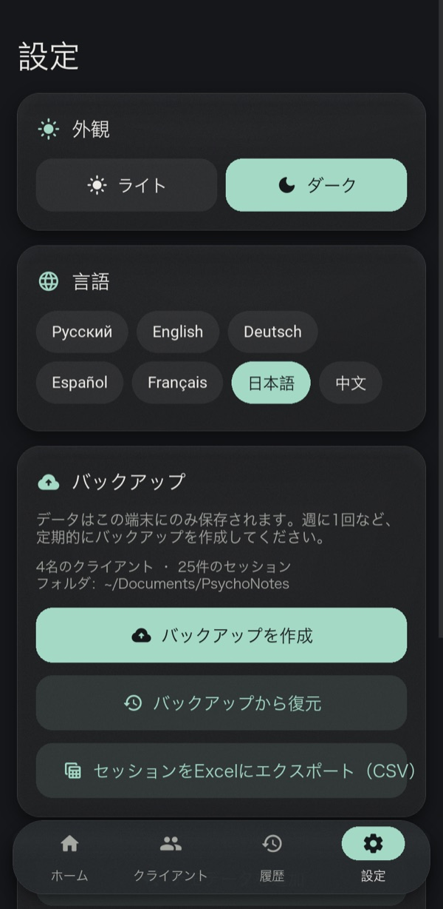
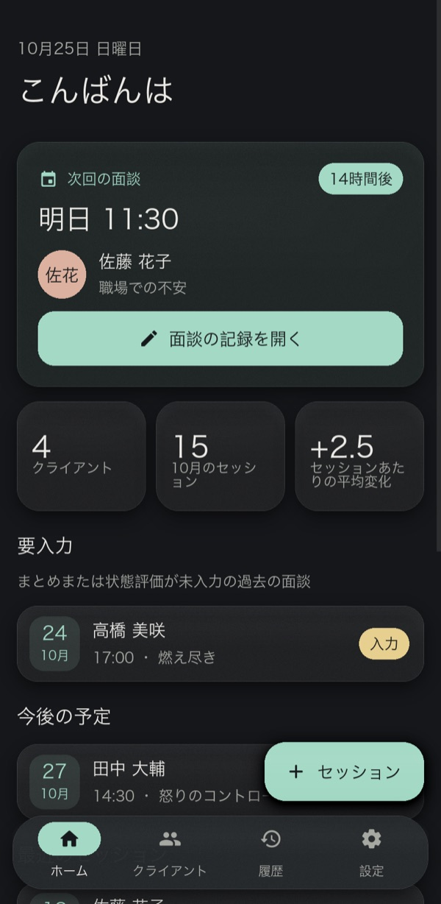
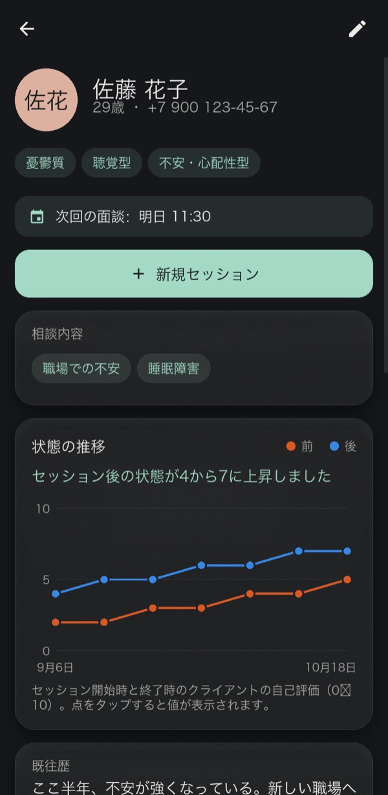

<div align="center">


# PsychoNotes

**開業心理士のための、プライベートなオフラインワークスペース。クライアント記録、セッションノート、経過の追跡を一か所にまとめます。**

[English](../README.md) · [Русский](README.ru.md) · [Deutsch](README.de.md) · [Español](README.es.md) · [Français](README.fr.md) · **日本語** · [中文](README.zh.md)







</div>

---

紙のメモは失くしがちですし、表計算ソフトはセラピーの進め方に合いません。PsychoNotes は、各クライアントのプロフィール、すべてのセッション、そして時間とともに変わるクライアントの状態を一か所で管理します。データが端末の外に出ることはありません。アカウントもクラウドもネットワークアクセスもありません。

インターフェースは英語、ロシア語、ドイツ語、スペイン語、フランス語、日本語、中国語の7言語に対応しています。初回起動時はシステムの言語に従い、設定からいつでも再起動なしで切り替えられます。

## 機能

### 大事なことを最初に
- **次の予約**がホーム画面の主役カードです。カウントダウンを表示し、ワンタップでそのセッションのノートを開きます。
- **要入力**には、結果や最終スコアがまだ未記入の過去のセッションが並ぶので、記録の書き忘れを防げます。
- 未完了のセッションにはリマインダーのバナーが表示されます。未保存の編集があるままフォームを閉じようとすると、破棄してよいか確認します。

### クライアントとセッション
- **クライアントプロフィール：** 年齢、電話番号、気質、知覚モダリティ、性格タイプ、既往歴、支援計画。
- **主訴：** クライアントには複数の主訴を登録できます。セッションを記録するとき、ワンタップで選べる候補として表示されます。
- **セッションフォーム**は4ステップ：面談、開始時、ワーク、結果。
- **状態スコア：** 開始時と終了時にそれぞれ0〜10で評価します。「不調」から「最高」まで、色分けされたスケールです。
- **かんたん入力：** 日付ピッカー、場所や天気のチップ、リストからのクライアント選択。新しいクライアントもその場で作成できます。
- **検索**は即時で、どの文字種でも大文字小文字を区別しません（キリル文字も対応）。クライアント、主訴、技法が対象です。

### 経過
- **クライアントごとのグラフ**で、セッションをまたいだ前後のスコアを確認できます。ポイントをタップ（またはホバー）すると値が表示されます。
- グラフの下には**わかりやすい言葉の要約**が出ます。例：「セッション後の状態が4から7に上昇しました」。
- **セッションごとの変化**（「+3」）が各セッションに表示されます。

### あなたのデータ
- **JSONでのバックアップと復元。** 復元の前にファイルを検証し、問題があれば完全にロールバックします。
- 全セッションの**CSVエクスポート**。列見出しはインターフェースの言語になり、Excelでもどの文字種も崩れずに開けます。
- **7言語**を設定でその場で切り替え可能。日付、複数形、デモデータも言語に合わせて変わります。
- ソフトなパステルカラーとマットなすりガラス調パネルの**ライトテーマとダークテーマ**。
- **デモデータ：** ワンタップで架空のクライアントを何人か読み込み、アプリを試せます。

<table>
<tr>
<td align="center" width="25%"><br><sub>4ステップのセッションフォーム</sub></td>
<td align="center" width="25%"><br><sub>未完了セッションのリマインダー</sub></td>
<td align="center" width="25%"><br><sub>クライアント</sub></td>
<td align="center" width="25%"><br><sub>テーマ、言語、バックアップ</sub></td>
</tr>
</table>

### ダークテーマ

<p align="center">


</p>

## はじめに

```bash
git clone https://github.com/efrom-K/PsychoNotes.git
cd PsychoNotes
python -m venv .venv && source .venv/bin/activate   # Windows: .venv\Scripts\activate
pip install -r requirements.txt
python main.py
```

初回起動時に **デモデータで見てみる** をタップすると、架空のクライアントを何人か読み込めます。

データベースはOSのユーザーデータフォルダにあります。例：macOS では `~/Library/Application Support/psychonotes/`、Windows では `%APPDATA%\psychonotes\`。バックアップは `~/Documents/PsychoNotes` に保存されます。Android ではアプリ専用フォルダに保存され、ファイルマネージャーから見えます。

### パッケージング

| ターゲット | コマンド |
|---|---|
| Android APK | `buildozer android debug`（設定は `buildozer.spec`）。arm64-v8a と armeabi-v7a 向けにビルドし、対応は Android 7.0 以上です。初回ビルドは約30分、2回目以降は約1分です。下記の注意事項も参照してください。 |
| Windows / macOS アプリ | `pyinstaller --name PsychoNotes --windowed --icon assets/icon.png --add-data "ui.kv:." --add-data "assets:assets" --add-data "locales:locales" main.py`（Windows では `:` の代わりに `;` を使います） |

<details>
<summary><b>macOS で APK をビルドする</b></summary>

- `openjdk@21` を `JAVA_HOME` に設定します。GNU `libtool` を `PATH` の先頭に置きます（`/opt/homebrew/opt/libtool/libexec/gnubin`）。buildozer は `VIRTUAL_ENV` を設定した仮想環境から実行します。
- 現在の python-for-android の master には、`.buildozer/android/platform/python-for-android` 内で2か所のローカル修正が必要です。
  - `pythonforandroid/recipes/kivy/__init__.py`：`python_depends = ['filetype']` に設定します。`requests` が Android 専用の `charset_normalizer` ホイールを引き込み、ホスト側の pip がインストールを拒否するためです。このアプリはネットワークリクエストを行わないので、失うものはありません。
  - `pythonforandroid/build.py` の `run_pymodules_install`：venv を `'-m', 'venv', '--clear', 'venv'` で作成します。そうしないと、2番目の ABI が最初の ABI の venv を再利用し、2種類の pip が混在して、pip が `ImportError: BuildDependencyInstallError` で失敗します。
- ログに出る `pip install ... --dry-run` の `Traceback` は無害です。ビルド済みの Android ホイールが存在しないという意味で、パッケージはソースからビルドされます。

</details>

## 内部構成

| | |
|---|---|
| **UI** | Kivy 2.3。すべてのレイアウトは単一の `ui.kv` にあります。KivyMD もサードパーティ製ウィジェットも使いません。 |
| **アイコン** | Material Icons Round を、アプリで使う33グリフだけに削減：400 KB から **6 KB** へ。 |
| **言語** | `tr()` は、ロシア語の原文を `locales/<lang>.json` から引き、なければ原文にフォールバックします。語順はテンプレートに含まれるため、日付、複数形、「2時間15分後」などがどの言語でも自然に読めます。日本語と中国語にはシステムの CJK フォント（Android では Noto Sans CJK）を使います。Roboto には漢字がないためです。 |
| **ストレージ** | SQLite（標準ライブラリ）。外部キーのカスケード、インデックス、検索用の Unicode 対応 `casefold()` SQL 関数を備えます。 |
| **リスト** | クライアント一覧と履歴には `RecycleView` を使い、画面に表示中の行だけを生成します。 |
| **ガラス効果** | 半透明の塗り、等倍のグレインテクスチャ、GPU `BoxShadow` 上のやわらかなハイライト。リアルタイムのぼかしやフレームごとの FBO は使いません。 |
| **起動** | 起動時に構築するのはホーム画面だけ。ほかの画面は初回表示時に作られます。 |

M シリーズ Mac で、クライアント300人・セッション6,000件のストレス用データベースを使って計測した結果：

| 指標 | 結果 |
|---|---|
| 起動から最初のフレームまで | 約0.5秒 |
| 6,000行の履歴のスクロール | 安定して 13 ms/フレーム（vsync 律速） |
| 最も重いクエリ（全セッション） | 約22 ms |
| 素の Kivy ウィンドウに対するメモリ増加 | +36 MB |
| アプリのソース + アセット | 約140 KB |

```
main.py          アプリ本体、ナビゲーション、各画面、グラフウィジェット
ui.kv            すべてのレイアウトとスタイル。色トークンは main.py のテーマから取得
database.py      SQLite 層。標準ライブラリのみ（Kivy 不使用）。バックアップ/復元と CSV を含む
i18n.py          翻訳の検索と複数形ルール
locales/         言語ごとに1つの JSON ファイル。ロシア語の原文をキーとする
fmt.py           ローカライズされた日付と「2時間15分後」
demo.py          架空のサンプルデータ
test_database.py データ層とフォーマットの単体テスト
test_i18n.py     全言語で全文字列が翻訳済みで、{プレースホルダー} が同一であることを検証
tools/           GUI スモークテスト、この README 用のスクリーンショット生成ツール
```

## テスト

```bash
python -m unittest                  # データ層、フォーマット、翻訳。Kivy は不要
.venv/bin/python tools/smoke.py     # GUI スモークテスト：実際のウィンドウで主要フローを操作
```

単体テストは Python 3.9 以上ならインストール不要で動きます。スモークテストはウィンドウを開き、主要なフローを一通り操作します。
- ピッカーを使ったクライアントとセッションの作成
- 未保存の変更の確認プロンプトと、不正な入力の拒否
- 削除、バックアップ、復元
- Kivy の入力ループを通した、ボタンへの実際のタッチ
- 言語のライブ切り替え、続いて全言語での全画面の確認

この README のスクリーンショットは `tools/screenshots.py` で生成されます。`PSYCHONOTES_LANG=en`（または別のコード）を設定すると、その言語で描画されます。

## プライバシー

- すべてのデータはローカルの SQLite ファイルに保存されます。アプリはネットワークリクエストを一切行いません。
- Google クラウドへの Android バックアップは無効です（`android.allow_backup = False`）。
- バックアップファイルは、中身の記録と同じように扱ってください。平文の JSON です。

## 翻訳

翻訳を直すには `locales/<lang>.json` を編集します。言語を追加するには、`python test_i18n.py keys > locales/xx.json` を実行して値を埋め、`i18n.py` の `LANGS` にコードを追加します。`python -m unittest test_i18n` で、不足しているキーと壊れたプレースホルダーを確認できます。

## 1.x からのアップグレード

データベースのスキーマは変わっていません。初回起動時に、2.0 はアプリフォルダにある既存の `psychologist_notes.db` をユーザーデータフォルダにコピーします。バージョン 2.0 では 1.x の不具合もいくつか修正されています。
- セッションを編集しても、クライアントの既往歴と主訴が消えなくなりました。
- クライアントを削除すると、そのセッションも一緒に削除されるようになりました。
- セッションは、入力した名前ではなくリストから選んだクライアントに紐づくため、タイプミスで重複クライアントができることはなくなりました。

## ライセンス

[MIT](../LICENSE) © Efim Romanchenko

アイコン：Google の [Material Icons](https://github.com/google/material-design-icons)、Apache License 2.0（サブセットは `assets/icons.otf`）。
