<div align="center">

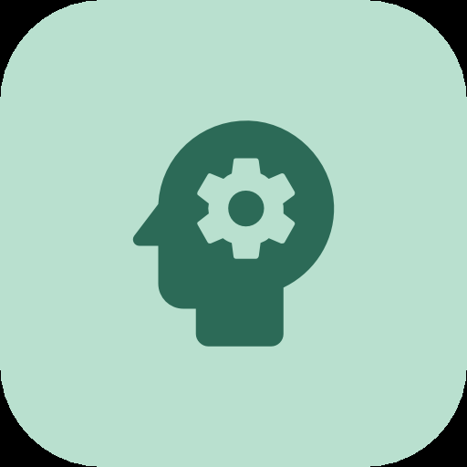

# PsychoNotes

**Приватное офлайн-рабочее место для практикующих психологов: карточки клиентов, заметки о сессиях и отслеживание динамики.**

[English](../README.md) · **Русский** · [Deutsch](README.de.md) · [Español](README.es.md) · [Français](README.fr.md) · [日本語](README.ja.md) · [中文](README.zh.md)


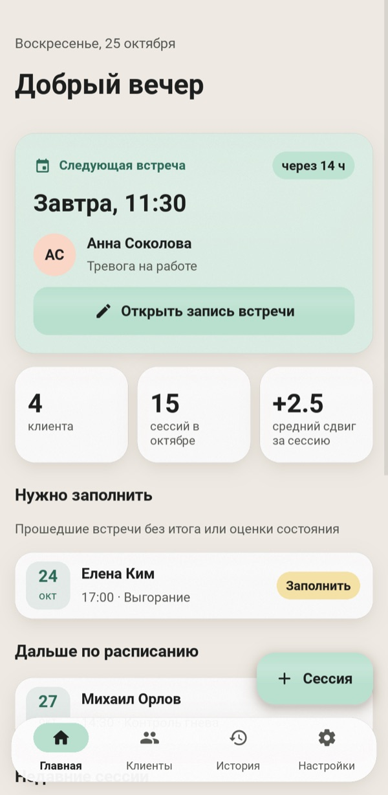
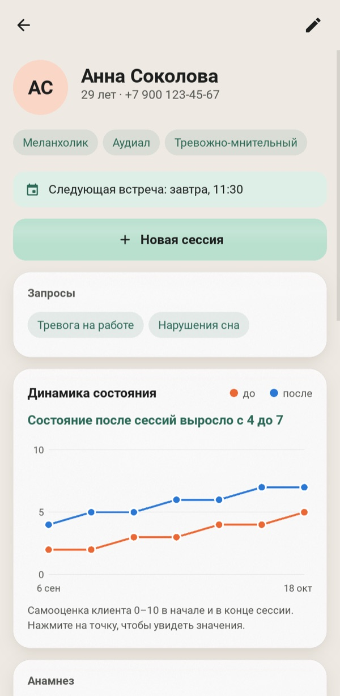
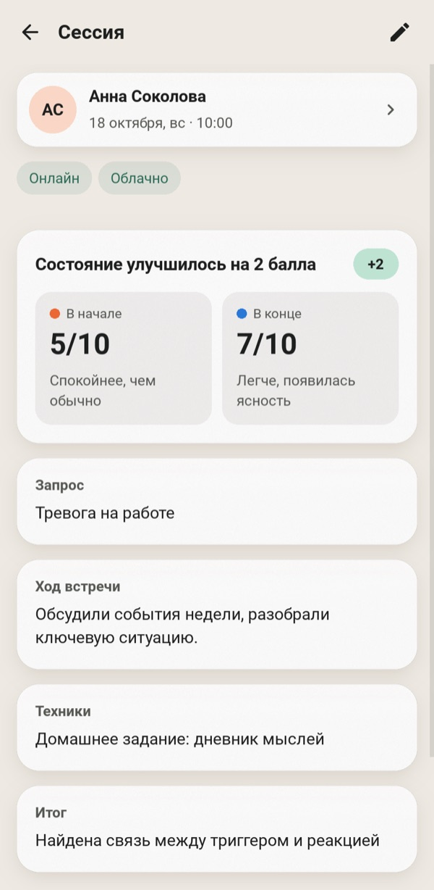
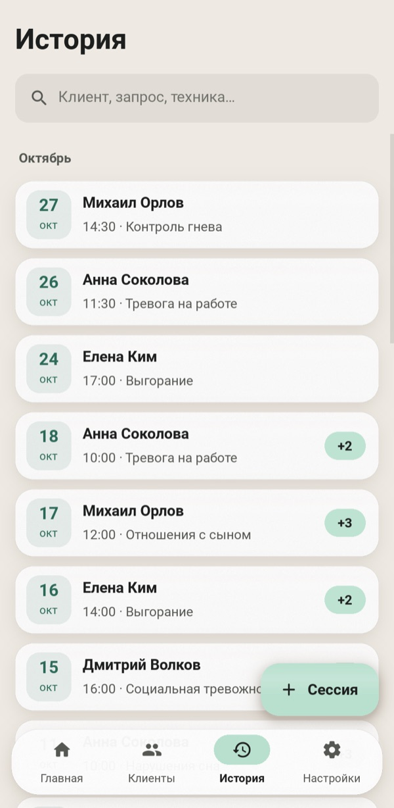

</div>

---

Бумажные заметки теряются, а таблицы не подходят под устройство терапии. PsychoNotes хранит в одном месте профиль каждого клиента, все сессии и изменения его состояния со временем. Ничего не покидает устройство: нет аккаунта, нет облака и нет доступа к сети.

Интерфейс доступен на семи языках: английском, русском, немецком, испанском, французском, японском и китайском. При первом запуске приложение берёт язык системы, а переключить его можно в любой момент в настройках, без перезапуска.

## Возможности

### Самое важное: на первом месте
- **Ближайшая встреча** — главная карточка на домашнем экране. Она показывает обратный отсчёт и одним касанием открывает заметки этой сессии.
- **Нужно заполнить** — список прошедших сессий, где ещё нет итога или финальной оценки, чтобы ни одна запись не потерялась.
- Незавершённая сессия показывает баннер-напоминание. При выходе из формы с несохранёнными правками приложение спросит, не отбросить ли их.

### Клиенты и сессии
- **Профиль клиента:** возраст, телефон, темперамент, модальность восприятия, тип характера, анамнез и план помощи.
- **Запросы:** у клиента может быть любое число запросов. При записи сессии они появляются как подсказки в одно касание.
- **Форма сессии** из четырёх шагов: встреча, в начале, работа, итог.
- **Оценки состояния:** от 0 до 10 в начале и в конце, по цветной шкале от «плохо» до «отлично».
- **Быстрый ввод:** выбор даты, чипы для места и погоды, выбор клиента из списка. Нового клиента можно создать прямо там же.
- **Поиск** мгновенный и не зависит от регистра в любом алфавите, включая кириллицу. Он охватывает клиентов, запросы и техники.

### Динамика
- **График по клиенту:** оценки до и после по сессиям. Коснитесь точки или наведите на неё курсор, чтобы увидеть значения.
- **Резюме простым языком** под графиком, например: «Состояние после сессий выросло с 4 до 7».
- **Изменение за сессию** («+3») показывается у каждой сессии.

### Ваши данные
- **Резервная копия и восстановление в JSON.** Перед восстановлением файл проверяется, а при любой ошибке всё откатывается полностью.
- **Экспорт в CSV** всех сессий, заголовки столбцов — на языке интерфейса. Открывается в Excel без потери символов любого алфавита.
- **Семь языков** с переключением на лету в настройках: даты, склонения и демо-данные тоже следуют за языком.
- **Светлая и тёмная темы** в мягких пастельных тонах с матовыми «стеклянными» панелями.
- **Демо-данные:** одно касание загружает нескольких вымышленных клиентов, чтобы познакомиться с приложением.

<table>
<tr>
<td align="center" width="25%">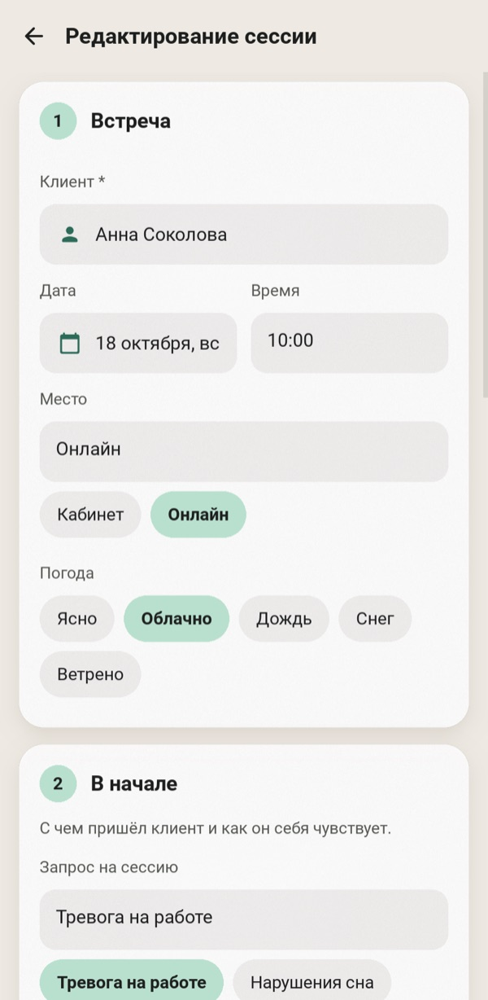<br><sub>Форма сессии из четырёх шагов</sub></td>
<td align="center" width="25%">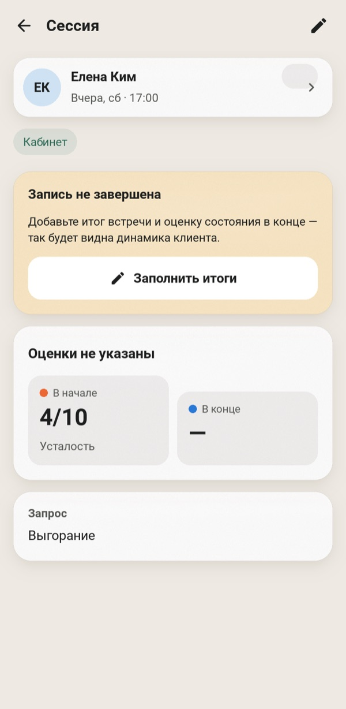<br><sub>Напоминание о незавершённой сессии</sub></td>
<td align="center" width="25%">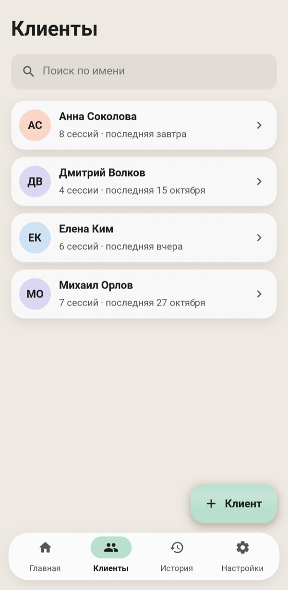<br><sub>Клиенты</sub></td>
<td align="center" width="25%">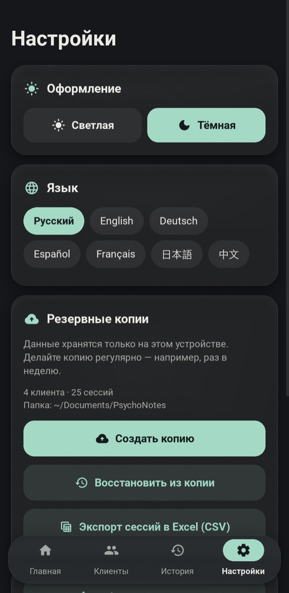<br><sub>Темы, языки, резервные копии</sub></td>
</tr>
</table>

### Тёмная тема

<p align="center">
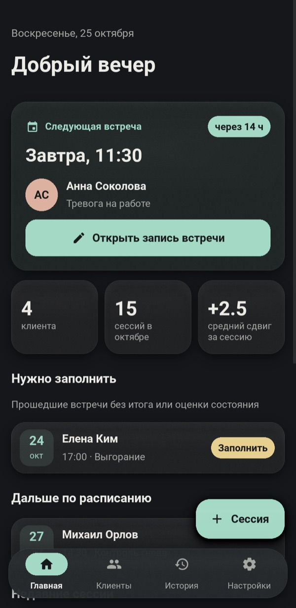
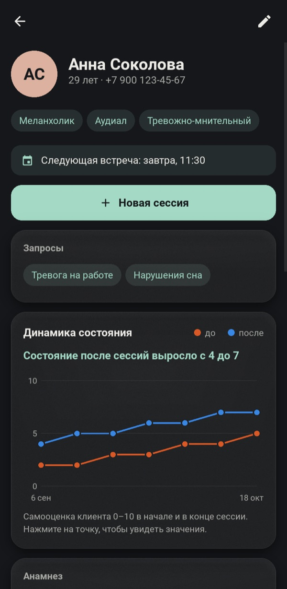
</p>

## Быстрый старт

```bash
git clone https://github.com/efrom-K/PsychoNotes.git
cd PsychoNotes
python -m venv .venv && source .venv/bin/activate   # Windows: .venv\Scripts\activate
pip install -r requirements.txt
python main.py
```

При первом запуске нажмите **Посмотреть на демо-данных**, чтобы загрузить нескольких вымышленных клиентов.

База данных лежит в пользовательской папке данных ОС, например `~/Library/Application Support/psychonotes/` на macOS или `%APPDATA%\psychonotes\` на Windows. Резервные копии сохраняются в `~/Documents/PsychoNotes`. На Android они попадают в собственную папку приложения, которую видно в файловых менеджерах.

### Сборка

| Цель | Команда |
|---|---|
| Android APK | `buildozer android debug` (конфигурация в `buildozer.spec`). Сборка для arm64-v8a и armeabi-v7a, минимум Android 7.0. Первая сборка занимает около 30 минут, последующие — около минуты. См. заметки ниже. |
| Приложение для Windows / macOS | `pyinstaller --name PsychoNotes --windowed --icon assets/icon.png --add-data "ui.kv:." --add-data "assets:assets" --add-data "locales:locales" main.py` (в Windows вместо `:` используйте `;`) |

<details>
<summary><b>Сборка APK на macOS</b></summary>

- Используйте `openjdk@21` в качестве `JAVA_HOME`. Поставьте GNU `libtool` первым в `PATH` (`/opt/homebrew/opt/libtool/libexec/gnubin`). Запускайте buildozer из виртуального окружения с заданной `VIRTUAL_ENV`.
- Текущему master python-for-android нужны две локальные правки в `.buildozer/android/platform/python-for-android`:
  - `pythonforandroid/recipes/kivy/__init__.py`: задайте `python_depends = ['filetype']`. `requests` тянет за собой колесо `charset_normalizer` только для Android, которое pip на хосте отказывается ставить. Приложение не делает сетевых запросов, так что ничего не теряется.
  - `pythonforandroid/build.py`, в `run_pymodules_install`: создавайте venv с `'-m', 'venv', '--clear', 'venv'`. Иначе вторая ABI переиспользует venv первой, смешиваются две версии pip, и pip падает с `ImportError: BuildDependencyInstallError`.
- Строки `Traceback` от `pip install ... --dry-run` в логе безвредны. Они означают лишь, что готового колеса для Android нет, и пакет собирается из исходников.

</details>

## Под капотом

| | |
|---|---|
| **UI** | Kivy 2.3, все раскладки в одном `ui.kv`. Без KivyMD и сторонних виджетов. |
| **Иконки** | Material Icons Round, урезанный до 33 используемых в приложении глифов: **6 КБ** вместо 400 КБ. |
| **Языки** | `tr()` ищет русскую исходную строку в `locales/<lang>.json` и при отсутствии перевода возвращается к ней. Порядок слов задают шаблоны, поэтому даты, склонения и «через 2 ч 15 мин» естественно читаются на каждом языке. Японский и китайский используют системный CJK-шрифт (Noto Sans CJK на Android), так как в Roboto нет иероглифов. |
| **Хранилище** | SQLite (stdlib) с каскадами внешних ключей, индексами и SQL-функцией `casefold()` с поддержкой Unicode для поиска. |
| **Списки** | `RecycleView` для клиентов и истории, поэтому существуют только строки, видимые на экране. |
| **Эффект стекла** | Полупрозрачная заливка, зернистая текстура 1:1 и мягкий блик на GPU-`BoxShadow`. Без размытия в реальном времени и без FBO на каждый кадр. |
| **Запуск** | При старте строится только главный экран. Остальные создаются при первом заходе. |

Замеры на Mac с чипом M-серии и нагрузочной базой из 300 клиентов и 6 000 сессий:

| Показатель | Результат |
|---|---|
| От запуска до первого кадра | ~0,5 с |
| Прокрутка истории из 6 000 строк | стабильные 13 мс/кадр (упирается в vsync) |
| Самый тяжёлый запрос (все сессии) | ~22 мс |
| Память сверх пустого окна Kivy | +36 МБ |
| Исходники приложения + ресурсы | ~140 КБ |

```
main.py          оболочка приложения, навигация, экраны, виджет графика
ui.kv            все раскладки и стили; цветовые токены берутся из темы в main.py
database.py      слой SQLite, чистая stdlib (без Kivy), с резервным копированием/восстановлением и CSV
i18n.py          поиск переводов и правила множественного числа
locales/         по одному JSON-файлу на язык, ключи — русские исходные строки
fmt.py           локализованные даты и «через 2 ч 15 мин»
demo.py          вымышленные демо-данные
test_database.py модульные тесты слоя данных и форматирования
test_i18n.py     все строки переведены на все языки, с теми же {плейсхолдерами}
tools/           GUI-смоук-тест, генератор скриншотов для этого README
```

## Тесты

```bash
python -m unittest                  # слой данных, форматирование и переводы, Kivy не нужен
.venv/bin/python tools/smoke.py     # GUI-смоук-тест: прогоняет реальные сценарии в живом окне
```

Модульные тесты работают на любом Python 3.9+ без установки чего-либо. Смоук-тест открывает окно и проходит основные сценарии:
- создание клиента и сессии через выбор из списков;
- запрос о несохранённых изменениях и отклонение некорректного ввода;
- удаление, резервное копирование и восстановление;
- реальное касание кнопки, пропущенное через цикл ввода Kivy;
- переключение языка «на лету», затем каждый экран на каждом языке.

Скриншоты в этом README создаются скриптом `tools/screenshots.py`. Задайте `PSYCHONOTES_LANG=ru` (или другой код), чтобы отрисовать их на этом языке.

## Конфиденциальность

- Все данные остаются в локальном файле SQLite. Приложение не делает сетевых запросов.
- Резервное копирование Android в облако Google отключено (`android.allow_backup = False`).
- Обращайтесь с файлами резервных копий как с самими записями: это обычный JSON.

## Переводы

Чтобы исправить перевод, отредактируйте `locales/<lang>.json`. Чтобы добавить язык, выполните `python test_i18n.py keys > locales/xx.json`, заполните значения и добавьте код в `LANGS` в `i18n.py`. `python -m unittest test_i18n` сообщает об отсутствующих ключах и сломанных плейсхолдерах.

## Обновление с 1.x

Схема базы данных не изменилась. При первом запуске версия 2.0 копирует существующий `psychologist_notes.db` из папки приложения в пользовательскую папку данных. Версия 2.0 также исправляет несколько ошибок 1.x:
- Редактирование сессии больше не стирает анамнез и запросы клиента.
- Удаление клиента теперь удаляет и его сессии.
- Сессия привязывается к клиенту, выбранному из списка, а не к введённому имени, поэтому опечатки больше не создают дубликаты клиентов.

## Лицензия

[MIT](../LICENSE) © Efim Romanchenko

Иконки: [Material Icons](https://github.com/google/material-design-icons) от Google, лицензия Apache 2.0 (подмножество в `assets/icons.otf`).
