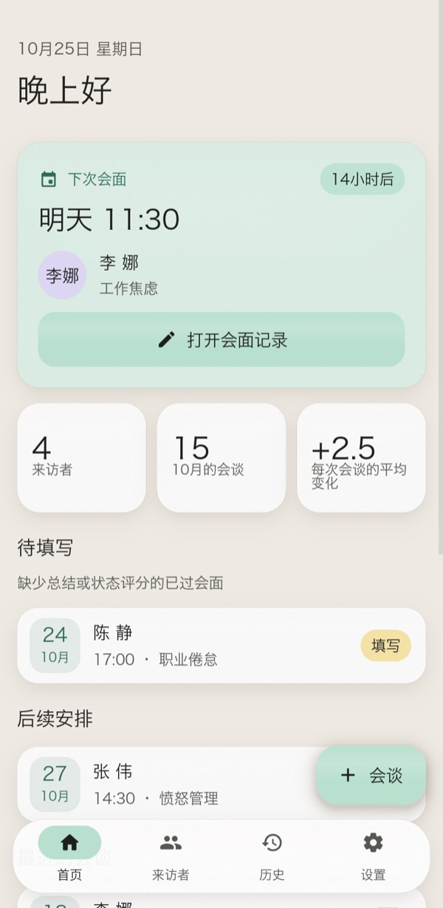
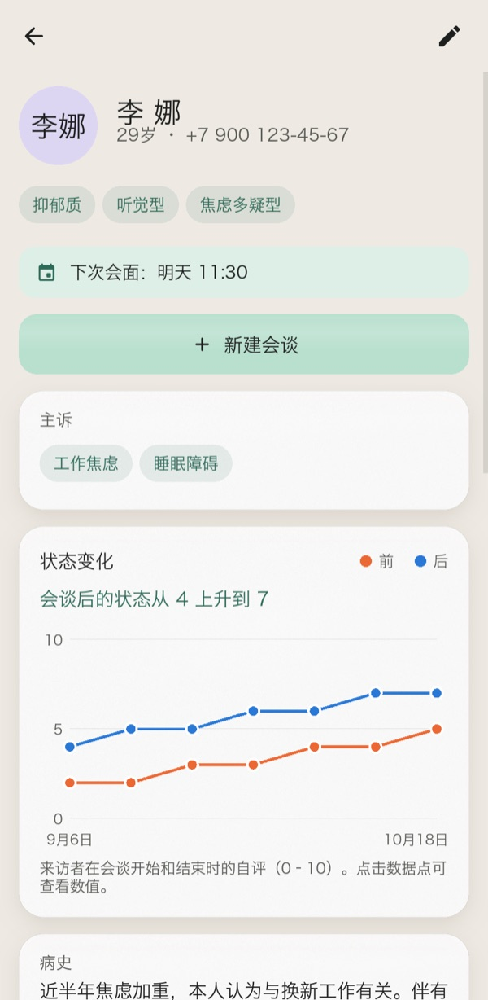
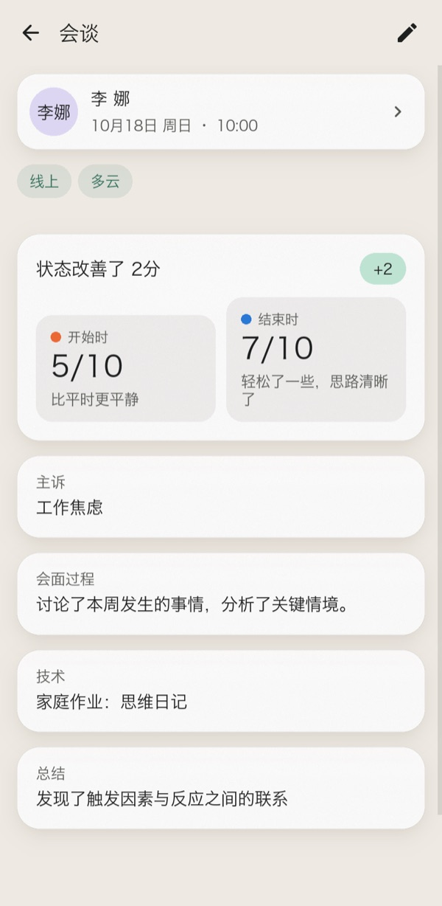
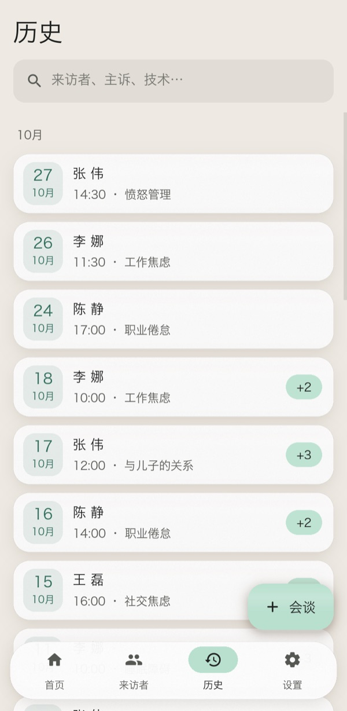
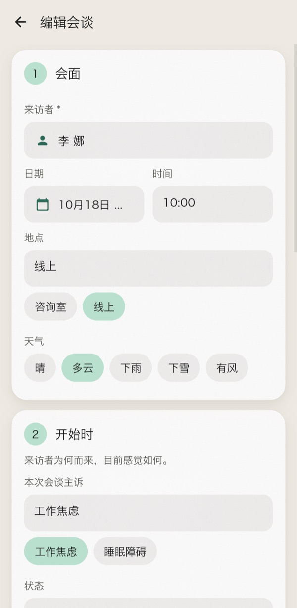
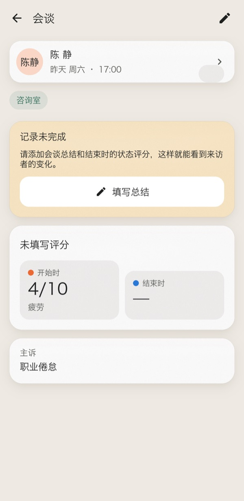
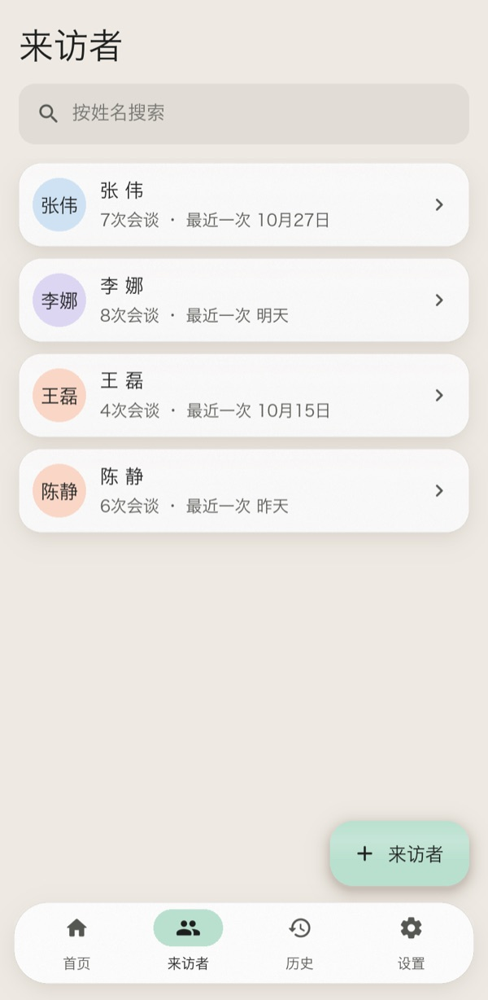
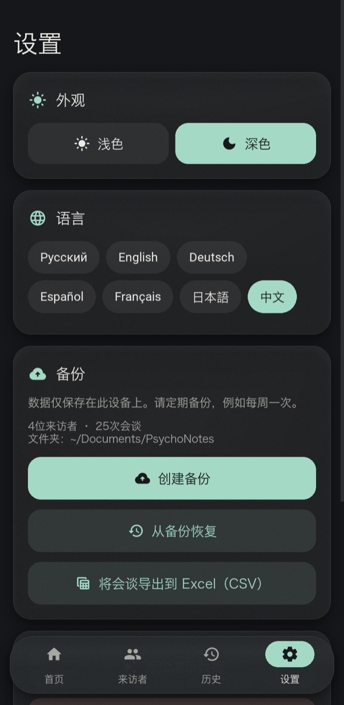
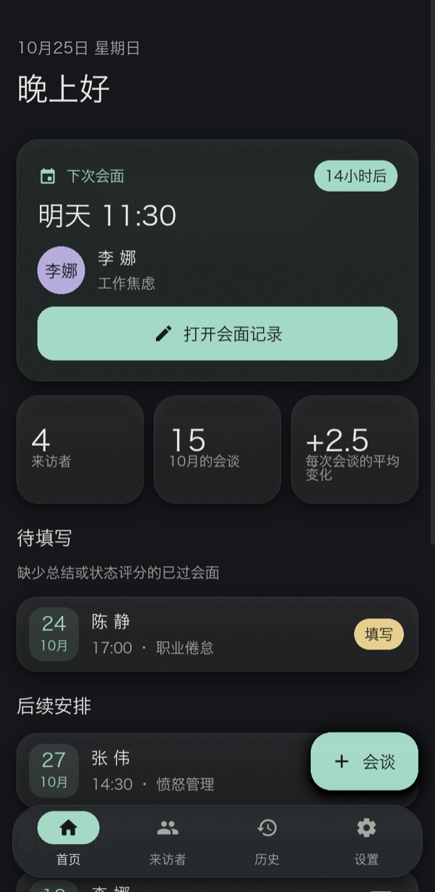
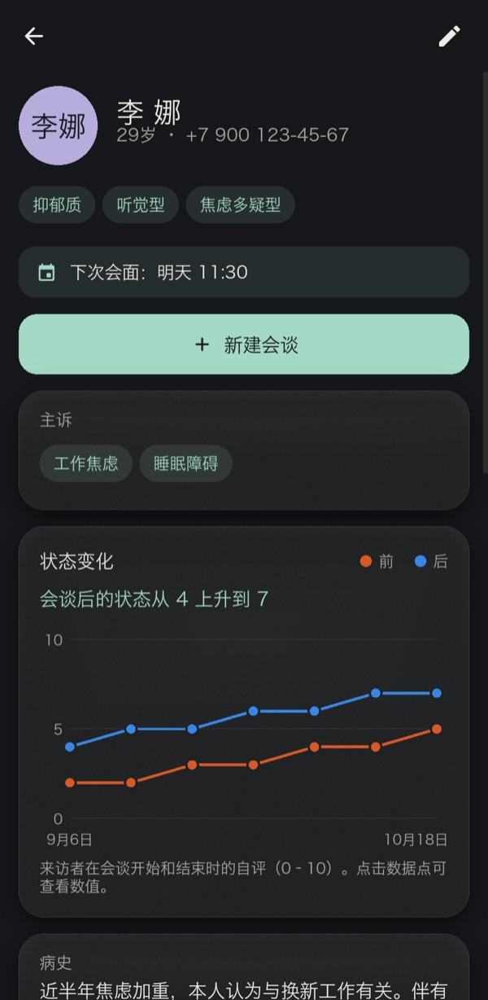

<div align="center">


# PsychoNotes

**为执业心理咨询师打造的私密离线工作台：来访者档案、会谈笔记与进展跟踪。**

[English](../README.md) · [Русский](README.ru.md) · [Deutsch](README.de.md) · [Español](README.es.md) · [Français](README.fr.md) · [日本語](README.ja.md) · **中文**







</div>

---

纸质笔记容易丢，电子表格又不适合咨询工作的节奏。PsychoNotes 把每位来访者的档案、每一次会谈，以及来访者随时间变化的状态集中在一处。数据不会离开设备：没有账号，没有云端，也没有任何网络访问。

界面支持七种语言：英语、俄语、德语、西班牙语、法语、日语和中文。首次启动时应用会跟随系统语言，你可以随时在“设置”中切换，无需重启。

## 功能

### 重要的事排在最前
- **下一次预约**是首页的主卡片，显示倒计时，点一下即可打开该次会谈的笔记。
- **待填写**列出仍缺少结果或最终评分的过往会谈，避免漏写记录。
- 未完成的会谈会显示提醒横幅。离开有未保存修改的表单时，会先询问是否放弃。

### 来访者与会谈
- **来访者档案：** 年龄、电话、气质、感知模态、性格类型、既往史和帮助计划。
- **求助问题：** 一位来访者可以有任意多个求助问题。记录会谈时，它们会作为一键选择的建议出现。
- **会谈表单**分四步：会面、开始时、咨询过程、结果。
- **状态评分：** 在开始和结束时各按 0–10 打分，色彩标注的刻度从“很差”到“很好”。
- **快捷输入：** 日期选择器、地点和天气的标签、从列表中选择来访者。新来访者可以当场创建。
- **搜索**即时响应，在任何文字中都不区分大小写（包括西里尔字母），范围涵盖来访者、求助问题和技术方法。

### 进展
- **每位来访者的图表**展示各次会谈前后的评分。点按或悬停在数据点上可查看数值。
- 图表下方有**通俗的文字小结**，例如“会谈后的状态从 4 上升到 7”。
- 每次会谈都会显示**单次变化**（“+3”）。

### 你的数据
- **JSON 备份与恢复。** 恢复前会先校验文件，若有任何问题则完全回滚。
- **CSV 导出**全部会谈，列标题使用界面语言。在 Excel 中打开时各种文字都不会乱码。
- **七种语言**，在“设置”中即时切换：日期、复数形式和演示数据也会随语言变化。
- **浅色和深色主题**，柔和的粉彩配色，搭配哑光磨砂面板。
- **演示数据：** 一键载入几位虚构的来访者，方便你试用应用。

<table>
<tr>
<td align="center" width="25%"><br><sub>四步会谈表单</sub></td>
<td align="center" width="25%"><br><sub>未完成会谈提醒</sub></td>
<td align="center" width="25%"><br><sub>来访者</sub></td>
<td align="center" width="25%"><br><sub>主题、语言、备份</sub></td>
</tr>
</table>

### 深色主题

<p align="center">


</p>

## 快速开始

```bash
git clone https://github.com/efrom-K/PsychoNotes.git
cd PsychoNotes
python -m venv .venv && source .venv/bin/activate   # Windows: .venv\Scripts\activate
pip install -r requirements.txt
python main.py
```

首次启动时，点按 **用演示数据体验**，即可载入几位虚构的来访者。

数据库位于操作系统的用户数据目录，例如 macOS 上的 `~/Library/Application Support/psychonotes/`，或 Windows 上的 `%APPDATA%\psychonotes\`。备份保存到 `~/Documents/PsychoNotes`。在 Android 上，备份保存到应用自己的文件夹，文件管理器可以看到。

### 打包

| 目标 | 命令 |
|---|---|
| Android APK | `buildozer android debug`（配置在 `buildozer.spec`）。构建 arm64-v8a 和 armeabi-v7a，最低支持 Android 7.0。首次构建约需 30 分钟，之后约一分钟。请参阅下方说明。 |
| Windows / macOS 应用 | `pyinstaller --name PsychoNotes --windowed --icon assets/icon.png --add-data "ui.kv:." --add-data "assets:assets" --add-data "locales:locales" main.py`（在 Windows 上，用 `;` 代替 `:`） |

<details>
<summary><b>在 macOS 上构建 APK</b></summary>

- 将 `openjdk@21` 设为 `JAVA_HOME`。把 GNU `libtool` 放在 `PATH` 最前面（`/opt/homebrew/opt/libtool/libexec/gnubin`）。在设置了 `VIRTUAL_ENV` 的虚拟环境中运行 buildozer。
- 当前 python-for-android 的 master 分支需要在 `.buildozer/android/platform/python-for-android` 中做两处本地修复：
  - `pythonforandroid/recipes/kivy/__init__.py`：设置 `python_depends = ['filetype']`。`requests` 会引入仅限 Android 的 `charset_normalizer` wheel，而主机上的 pip 拒绝安装它。应用不发起任何网络请求，所以没有损失。
  - `pythonforandroid/build.py` 中的 `run_pymodules_install`：用 `'-m', 'venv', '--clear', 'venv'` 创建 venv。否则第二个 ABI 会复用第一个 ABI 的 venv，两个版本的 pip 混在一起，pip 会因 `ImportError: BuildDependencyInstallError` 而失败。
- 日志中 `pip install ... --dry-run` 产生的 `Traceback` 行是无害的。它们只表示不存在预编译的 Android wheel，因此该包会从源码构建。

</details>

## 技术细节

| | |
|---|---|
| **界面** | Kivy 2.3，所有布局都在单个 `ui.kv` 中。不使用 KivyMD，也没有第三方控件。 |
| **图标** | Material Icons Round，裁剪到应用实际用到的 33 个字形：**6 KB**，而不是 400 KB。 |
| **语言** | `tr()` 以俄语原文为键，在 `locales/<lang>.json` 中查找译文，找不到则回退到原文。语序由模板决定，因此日期、复数形式以及“2 小时 15 分钟后”在每种语言中读起来都自然。日语和中文使用系统的 CJK 字体（Android 上是 Noto Sans CJK），因为 Roboto 不含表意文字。 |
| **存储** | SQLite（标准库），带外键级联、索引，以及用于搜索、支持 Unicode 的 `casefold()` SQL 函数。 |
| **列表** | 来访者和历史记录使用 `RecycleView`，因此只会创建屏幕上可见的行。 |
| **玻璃效果** | 半透明填充、1:1 的颗粒纹理，以及 GPU `BoxShadow` 上的柔和高光。没有实时模糊，也没有逐帧 FBO。 |
| **启动** | 启动时只构建首页，其他屏幕在首次访问时才创建。 |

在 M 系列 Mac 上，使用包含 300 位来访者和 6,000 次会谈的压力测试数据库测得：

| 指标 | 结果 |
|---|---|
| 启动到首帧 | 约 0.5 秒 |
| 滚动 6,000 行历史记录 | 稳定 13 ms/帧（受垂直同步限制） |
| 最重的查询（全部会谈） | 约 22 ms |
| 比裸 Kivy 窗口多占的内存 | +36 MB |
| 应用源码 + 资源 | 约 140 KB |

```
main.py          应用外壳、导航、各屏幕、图表控件
ui.kv            所有布局和样式；颜色令牌来自 main.py 中的主题
database.py      SQLite 层，纯标准库（不依赖 Kivy），含备份/恢复和 CSV
i18n.py          译文查找与复数规则
locales/         每种语言一个 JSON 文件，以俄语原文为键
fmt.py           本地化的日期和“2 小时 15 分钟后”
demo.py          虚构的示例数据
test_database.py 数据层和格式化的单元测试
test_i18n.py     每种语言的每条字符串都已翻译，且 {占位符} 一致
tools/           GUI 冒烟测试、本 README 的截图生成器
```

## 测试

```bash
python -m unittest                  # 数据层、格式化和翻译，无需 Kivy
.venv/bin/python tools/smoke.py     # GUI 冒烟测试：在真实窗口中驱动实际流程
```

单元测试可在任何 Python 3.9+ 上运行，无需安装任何东西。冒烟测试会打开一个窗口，走一遍主要流程：
- 通过选择器创建来访者和会谈；
- 未保存修改的提示，以及对无效输入的拒绝；
- 删除，以及备份和恢复；
- 经由 Kivy 输入循环传递的、对按钮的真实触摸；
- 实时切换语言，然后检查每种语言下的每个屏幕。

本 README 中的截图由 `tools/screenshots.py` 生成。设置 `PSYCHONOTES_LANG=en`（或其他语言代码），即可用该语言渲染。

## 隐私

- 所有数据都保存在本地 SQLite 文件中。应用不发起任何网络请求。
- 已关闭 Android 向 Google 云端的备份（`android.allow_backup = False`）。
- 请像对待其中的记录一样对待备份文件：它们是明文 JSON。

## 翻译

要修正翻译，请编辑 `locales/<lang>.json`。要添加语言，运行 `python test_i18n.py keys > locales/xx.json`，填入译文，并把语言代码加到 `i18n.py` 的 `LANGS` 中。`python -m unittest test_i18n` 会报告缺失的键和损坏的占位符。

## 从 1.x 升级

数据库结构没有变化。首次启动时，2.0 会把应用文件夹中已有的 `psychologist_notes.db` 复制到用户数据目录。2.0 版本还修复了 1.x 中的若干缺陷：
- 编辑会谈不再清空来访者的既往史和求助问题。
- 删除来访者现在也会删除其会谈。
- 会谈关联的是从列表中选择的来访者，而不是手动输入的姓名，因此打错字不会再产生重复的来访者。

## 许可证

[MIT](../LICENSE) © Efim Romanchenko

图标：Google 的 [Material Icons](https://github.com/google/material-design-icons)，Apache License 2.0（子集位于 `assets/icons.otf`）。
